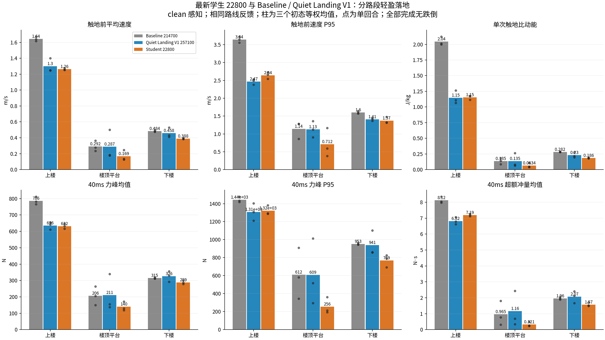
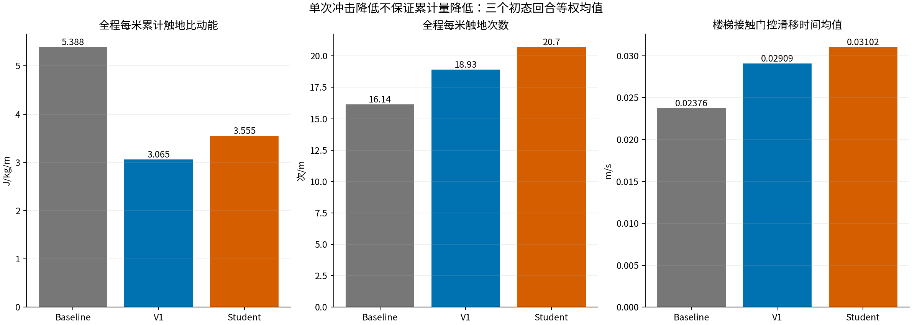
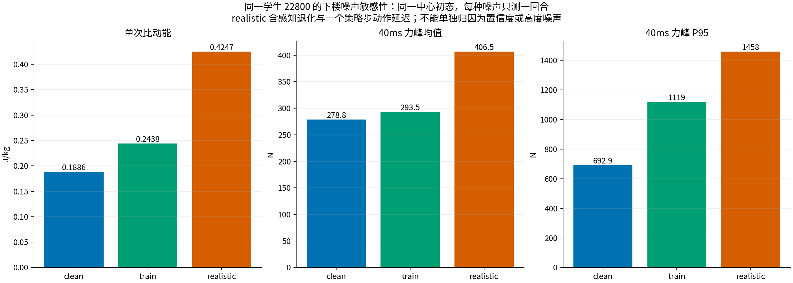

# 最新学生与早期 Baseline、Quiet Landing V1 的轻盈落地比较

**结论：学生保留了多数相对早期 Baseline 的落地优势，没有整体退回 Baseline 水平；相对来源 V1，干净观测下上楼速度尾部、冲量和累计能量有轻度回退，下楼单次冲击反而较低。全程累计触地比动能较 V1 增加约 16%，不能只看单次力峰降低就称为全面改善。realistic 噪声的单回合下楼测量出现明显变硬。**

## 固定对象与实验条件

冻结时间：2026-10-13T12:18:01.400942+08:00。学生取冻结时已保存的最新 `model_22800.pt`；训练之后继续产生的 checkpoint 未追入本轮。教师为学生实际来源 `model_257100.pt`，Baseline 为进入 Quiet Landing 训练之前的 `model_214700.pt`。

三者在真实闭环 MuJoCo 接触求解下分别独立控制，使用同一机器人 XML、地形、关节映射、PD、动作缩放和触地采样器，CPU 确定性推理，没有训练、优化器更新或部署模型替换。

- 地形：现有 `all_terrain.xml`，包含上楼、平台、下楼、坡、粗糙路面、障碍与低摩擦路面。
- 主对照：三模型 × 三组初态，均 clean 感知。初态是中心，以及 y/yaw 各 −0.03m/−0.03rad、+0.03m/+0.03rad，三者逐项一致；这些是敏感性测量，不是多种子随机统计显著性试验。
- 同一外部路线反馈：世界前进目标 0.5m/s、横向居中及航向纠偏；反馈算法相同，实际命令随各自姿态变化。不能据此证明手动控制下也有相同结果。
- 物理 5ms、策略 20ms，最大 120s；首个跌倒、轮心越出边界或全部轮足越过终点即停止。三者都使用现有 0.22m 机身离地高度、Rzz=0.35 的跌倒保护。
- 次对照：学生固定同一中心初态，分别 train（保存的 level=0.25 感知）和 realistic（level=1、几何可见性、proprio 噪声和一个策略步动作延迟），各一次。教师/Baseline 在这两组未施加对应噪声，只用学生自身 clean 中心回合来度量观测退化影响。

## 通行与资源

|模型 / 感知|完成回合|通行耗时范围 s|
|---|---:|---:|
|Baseline 214700 / clean|3/3|79.30–79.96|
|Quiet Landing V1 257100 / clean|3/3|80.84–82.42|
|Student 22800 / clean|3/3|77.40–77.82|
|Student 22800 / train|1/1|82.56|
|Student 22800 / realistic|1/1|79.20|

本轮 11 回合均完成、无跌倒、无轮心越出路线边界。单进程顺序评测、Torch/BLAS 一线程、CUDA 禁用；峰值 RSS 1149.9 MiB，11 回合总执行耗时 236.5 秒。完成终点不保证每个障碍都无绕行，未将通行成功等同于轻盈落地成功。

## 干净感知下三模型对照

下表每个数是三个初态回合分别统计后等权求均值，P95 也是每回合事件 P95 的均值。变化为“学生三回合均值 / 参考模型三回合均值 − 1”。逐初态配对变化及范围另存 metrics.json；没有把每个触地事件当成独立回合做显著性检验。

### 上楼

|指标|Baseline 214700|V1 257100|学生 22800|学生相对 Baseline|学生相对 V1|
|---|---:|---:|---:|---:|---:|
|触地前平均速度 (m/s)|1.643|1.299|1.263|-23.15%|-2.80%|
|触地前速度 P95 (m/s)|3.641|2.468|2.643|-27.41%|+7.12%|
|单次触地比动能 (J/kg)|2.045|1.146|1.155|-43.52%|+0.80%|
|每米累计触地比动能 (J/kg/m)|33.933|16.469|17.542|-48.30%|+6.51%|
|40ms 力峰均值 (N)|786.2|635.7|631.9|-19.63%|-0.59%|
|40ms 力峰 P95 (N)|1443.3|1307.2|1321.3|-8.45%|+1.08%|
|每回合最大力峰 (N)|1618.1|1416.5|1487.8|-8.05%|+5.04%|
|40ms 超额冲量均值 (N·s)|8.121|6.818|7.192|-11.44%|+5.48%|
|接触门控滑移时间均值 (m/s)|0.0408|0.0537|0.0473|+16.06%|-11.81%|
|触地事件数（3 回合合计）|91|79|83|—|—|

### 楼顶平台

|指标|Baseline 214700|V1 257100|学生 22800|学生相对 Baseline|学生相对 V1|
|---|---:|---:|---:|---:|---:|
|触地前平均速度 (m/s)|0.292|0.287|0.169|-42.02%|-41.19%|
|触地前速度 P95 (m/s)|1.141|1.128|0.712|-37.65%|-36.92%|
|单次触地比动能 (J/kg)|0.135|0.135|0.063|-53.03%|-53.05%|
|每米累计触地比动能 (J/kg/m)|0.915|1.108|0.830|-9.27%|-25.04%|
|40ms 力峰均值 (N)|206.1|210.7|139.6|-32.28%|-33.74%|
|40ms 力峰 P95 (N)|611.9|608.6|255.8|-58.19%|-57.96%|
|每回合最大力峰 (N)|805.1|988.8|775.1|-3.73%|-21.61%|
|40ms 超额冲量均值 (N·s)|0.965|1.158|0.321|-66.71%|-72.27%|
|接触门控滑移时间均值 (m/s)|0.0080|0.0090|0.0119|+49.87%|+32.12%|
|触地事件数（3 回合合计）|40|67|95|—|—|

### 下楼

|指标|Baseline 214700|V1 257100|学生 22800|学生相对 Baseline|学生相对 V1|
|---|---:|---:|---:|---:|---:|
|触地前平均速度 (m/s)|0.484|0.458|0.388|-19.75%|-15.11%|
|触地前速度 P95 (m/s)|1.600|1.409|1.369|-14.39%|-2.83%|
|单次触地比动能 (J/kg)|0.282|0.230|0.186|-34.22%|-19.25%|
|每米累计触地比动能 (J/kg/m)|15.137|12.134|11.763|-22.29%|-3.06%|
|40ms 力峰均值 (N)|314.9|325.9|288.6|-8.33%|-11.43%|
|40ms 力峰 P95 (N)|952.9|940.5|769.1|-19.29%|-18.23%|
|每回合最大力峰 (N)|1599.5|1538.5|1340.3|-16.20%|-12.89%|
|40ms 超额冲量均值 (N·s)|1.965|2.067|1.569|-20.14%|-24.07%|
|接触门控滑移时间均值 (m/s)|0.0289|0.0358|0.0433|+49.58%|+20.93%|
|触地事件数（3 回合合计）|297|309|362|—|—|

### 楼梯总体

|指标|Baseline 214700|V1 257100|学生 22800|学生相对 Baseline|学生相对 V1|
|---|---:|---:|---:|---:|---:|
|触地前平均速度 (m/s)|0.713|0.567|0.483|-32.28%|-14.78%|
|触地前速度 P95 (m/s)|2.466|1.888|1.763|-28.49%|-6.64%|
|单次触地比动能 (J/kg)|0.644|0.368|0.313|-51.42%|-14.98%|
|每米累计触地比动能 (J/kg/m)|16.122|9.649|9.739|-39.59%|+0.94%|
|40ms 力峰均值 (N)|405.4|354.8|315.1|-22.28%|-11.20%|
|40ms 力峰 P95 (N)|1364.0|1122.2|988.0|-27.57%|-11.96%|
|每回合最大力峰 (N)|1628.3|1538.5|1487.8|-8.63%|-3.30%|
|40ms 超额冲量均值 (N·s)|3.185|2.680|2.218|-30.35%|-17.22%|
|接触门控滑移时间均值 (m/s)|0.0238|0.0291|0.0310|+30.55%|+6.63%|
|触地事件数（3 回合合计）|428|455|540|—|—|

### 全地形

|指标|Baseline 214700|V1 257100|学生 22800|学生相对 Baseline|学生相对 V1|
|---|---:|---:|---:|---:|---:|
|触地前平均速度 (m/s)|0.432|0.300|0.281|-35.00%|-6.35%|
|触地前速度 P95 (m/s)|1.924|1.341|1.414|-26.51%|+5.47%|
|单次触地比动能 (J/kg)|0.334|0.163|0.172|-48.58%|+5.37%|
|每米累计触地比动能 (J/kg/m)|5.388|3.065|3.555|-34.02%|+15.97%|
|40ms 力峰均值 (N)|284.6|229.8|209.7|-26.33%|-8.77%|
|40ms 力峰 P95 (N)|977.4|778.3|768.3|-21.39%|-1.29%|
|每回合最大力峰 (N)|1693.5|1538.5|1494.9|-11.73%|-2.83%|
|40ms 超额冲量均值 (N·s)|2.044|1.450|1.242|-39.24%|-14.31%|
|接触门控滑移时间均值 (m/s)|0.0156|0.0170|0.0176|+12.69%|+3.27%|
|触地事件数（3 回合合计）|1906|2241|2448|—|—|

## 退化发生在哪里

1. **上楼：平均落地速度和平均力峰基本保留，但较硬的速度尾部和累积量回退。** 相对 V1，平均速度 -2.80%、平均力峰 -0.59%；速度 P95 +7.12%、每米比动能 +6.51%、超额冲量 +5.48%。相对 Baseline，上楼单次比动能仍低 43.52%，平均力峰低 19.63%。
2. **下楼：单次冲击没有退化到教师或 Baseline 水平。** 相对 V1，平均速度 -15.11%、单次比动能 -19.25%、平均力峰 -11.43%、超额冲量 -24.07%。但学生每米触地次数高 17.59%，每米累计能量仅低 3.06%，单次冲击降低不等于总量同幅降低。
3. **全程：累计冲击代理量比教师高，单次力峰较低。** 学生每米能量 3.555 对 V1 的 3.065 J/kg/m，增加 15.97%；平均力峰却降低 8.77%。每米触地次数增加 9.35%，单次比动能增加 5.37%。改用前向正进度分母仍增加 15.87%，累计差异没有因去掉侧向行程分母而消失。
4. **滑移并未全面改善。** 楼梯总体接触门控滑移时间均值相对 V1 +6.63%、相对 Baseline +30.55%。该值是四轮接触门控后、按全段时间平均；不是只在接触期间归一化的速度。

因此本轮支持“部分指标回退”，不支持“整个轻盈落地能力统一退化某个百分比”。平均事件强度、尾部冲击、每米累计量和滑移分别回答不同问题。

## 学生在观测噪声下的变化

以下三回合只比较同一个学生、同一中心初态。噪声会改变整条闭环轨迹；realistic 还增加了动作延迟，因此不能把变化单独归因为高程误差或置信度设计。

|下楼指标|clean|train|realistic|realistic 相对 clean|
|---|---:|---:|---:|---:|
|触地前平均速度 (m/s)|0.388|0.471|0.672|+73.31%|
|触地前速度 P95 (m/s)|1.474|1.636|2.031|+37.81%|
|单次触地比动能 (J/kg)|0.189|0.244|0.425|+125.21%|
|每米累计触地比动能 (J/kg/m)|11.906|11.777|13.818|+16.06%|
|40ms 力峰均值 (N)|278.8|293.5|406.5|+45.80%|
|40ms 力峰 P95 (N)|692.9|1118.8|1458.3|+110.46%|
|每回合最大力峰 (N)|1361.9|1352.0|1813.6|+33.16%|
|40ms 超额冲量均值 (N·s)|1.482|1.811|3.215|+116.94%|
|接触门控滑移时间均值 (m/s)|0.0367|0.0265|0.0250|-31.75%|

realistic 单回合下楼平均速度 0.672m/s、比动能 0.425J/kg、平均力峰 406.5N。相对 clean 中心学生，分别上升 73.3%、125.2%、45.8%。在这一噪声条件下，不能沿用 clean 下楼较柔和的结论。

为了说明量级，realistic 学生下楼平均力峰约 406.5N，超过 clean Baseline 中心回合约 310.7N 与 clean V1 中心回合约 356.0N；**这涉及不同观测/动作延迟条件，不是公平同噪声的模型优劣证明**。train 单回合下楼力峰 P95 也从 clean 的约 692.9N 增至约 1118.8N，仍需更多噪声样本确认其出现频率。

上楼 realistic 的单次强度反而下降，说明噪声影响随路段、轨迹和触地方式变化，不能用全程平均掩盖下楼的问题。两种噪声各一回合，未作泛化通过率或统计显著性结论；这些噪声参数仍是工程假设，未用真雷达实测标定。

## 采样定义与核验

- 触地速度取碰撞求解前轮心沿原始扫描估计法向的接近速度；无有效法向拟合时退回竖直法向。碰撞求解后使用真实静态地形接触力判断触地，学生低置信度不屏蔽真实触地事件。
- 比动能为 v²/2；轮体动能乘 wheel mass，均为代理量，不等于整机有效碰撞能量、声音或声压。
- 触地后 8 个 5ms 求解步取真实接触合力模长峰值；超额冲量为这 40ms 内估计法向接触力超过原设置 100N 的积分。末尾不足 40ms 的事件排除。
- 按机身 x 划分路段：上楼 [1,2.8)、平台 [2.8,4.8)、下楼 [4.8,6.6)。前后轮可能跨段；排除开始 100ms 的初始化保护和机身不在 [-1,38) 的事件。
- 每米量按相应路段内各 5ms 物理步的实际 XY 行程累计；同时提供前向正进度分母，避免侧向行程掩盖累计强度。
- 主对照仅纳入无跌倒、完成且未出界回合；失败会单列，本轮不存在被排除的失败回合。采用站立初态，不包含键盘 Z/C 起身与切换行为。
- 已复现历史已知 Baseline 的全地形、上楼、下楼触地事件数、平均速度、比动能与力峰均值，数值在 1e-6 容差内一致；三者同组初态 qpos/qvel 一致。所有选定物理数组有限，5ms 时序、v²/2 与接触向量模长恒等式通过。
- 模型、checkpoint、源代码、地形哈希在开跑前冻结并在开跑后重新核验。触地数据来自 200Hz 实际物理求解，没有用 50Hz 姿态插值来推算力峰。

## 产物

- [冻结测试条件与三模型指纹](criteria.json)
- [完整分回合、分路段数值及配对变化范围](metrics.json)
- [三模型对照 CSV](comparison.csv)
- [核验与历史 Baseline 复现证据](validation.json)
- [11 回合通行摘要](suite_summary.json)
- 各回合子目录：`quiet.npz`（200Hz）、`telemetry.npz`（50Hz）、`touchdowns.csv`、`summary.json`。
- `evaluate.py`、`analyze.py`、`report.py` 保留用于复现；正式训练与键盘部署程序未修改。

未测：自由手动操控、多速度/多楼梯高度、多个真实传感器噪声样本、声学和真机。外部路线反馈下的 sim2sim 结果不能代替这些能力验收。
