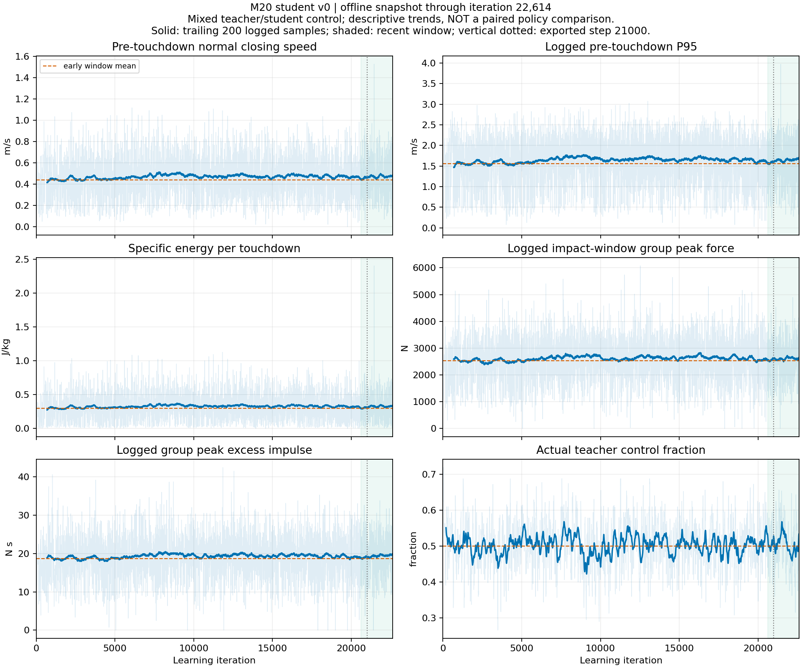

# M20 学生 V0：轻盈落地是否退化的离线分析

**结论：现有混合控制日志有落地变硬的趋势；无法据此确认学生相对固定教师退化，也无法给出学生独立的准确退化率。** 落地速度、能量和冲击统计相对早期上升幅度有限，没有出现数量级恶化，但当前证据也不能排除学生独立性能存在更大差异。

仅解析已有 TensorBoard 和 NPZ 文件，未启动训练、策略推理、MuJoCo/Isaac 仿真或真机；未修改环境、策略、部署程序或模型。此前键盘版部署未运行的状态不变。

## 数据对象与快照

- 学生运行：`2026-10-12_23-24-52_380795_student_v0_stage_a`。
- 快照最后迭代：22614；最后事件时间：2026-10-13T12:08:04.992317+08:00。读取时文件增长，本报告是读取快照，不是训练结束报告。
- 来源固定教师：Quiet Landing V1 `model_257100.pt`，SHA256 `368fa6287d3fc5e999b4ad596ad9f84be23f25d72bbd861236ec535a66b51c1c`。
- 最近窗口：20615–22614；前一窗口：18615–20614。教师实际执行时间步比例近期平均 0.50519，并非学生独立控制。
- 当前 MuJoCo 已导出学生是 `model_21000.pt`，SHA256 `e3c08b47f6aba6898a34add1aacd29f547679668da4a03e4ded5d4576fd754d9`。本报告没有更换部署模型。

## 蒸馏运行内部的落地趋势

以下均为各窗口已记录 TensorBoard scalar 的算术均值，**变化列表示日志变化，不能解释成模型能力的因果退化率**。地形 curriculum、命令、重置组大小和事件组成未固定；日志未按控制器或路段区分。

|指标|单位|早期 1000–1999|近期 20615–22614|变化|
|---|---|---:|---:|---:|
|触地前法向接近速度均值|m/s|0.4410|0.4717|+6.95%|
|触地前速度 P95 日志值|m/s|1.5598|1.6400|+5.14%|
|单次触地比动能均值|J/kg|0.2988|0.3251|+8.80%|
|每米累计触地比动能|J/kg/m|4.2840|4.6124|+7.67%|
|冲击窗口峰值力日志值|N|2535.0|2606.3|+2.81%|
|冲击窗口超额冲量日志值|N·s|18.634|19.366|+3.93%|
|接触滑移速度时间均值|m/s|0.1216|0.1216|-0.04%|

触地前速度/单次比动能近期各有 1713 个 scalar 记录，早期 533 个；这些不是独立触地事件数。近期 `QuietLanding/all/has_samples` 均值 0.99744，不存在大量无事件记录导致全部落地指标归零的现象。

相比前一两千轮：平均速度 +1.45%、单次比动能 +1.84%、峰值力 +0.98%。这次最新窗口略回升，不能沿用上一份截至 20618 轮报告中的“最近窗口改善”描述。

四轮单次比动能相对早期：FL +9.20%、FR +9.59%、HL +5.46%、HR +10.16%。没有只靠四轮总均值掩盖某一轮明显相反变化，但这些仍是混合控制统计。

整体动作 MSE 从早期 0.014677 到近期 0.010212（-30.43%）；平均 episode 长度从 997.48 到 997.87 步。动作拟合改善与落地更柔和并未同步；存活时间接近上限也不能代替柔和落地验收。

## 已部署 21000 模型对应训练阶段

取 19001–21000 的训练窗口，**这是更新过程中经过多个 checkpoint 的混合控制日志，不能称为固定 model_21000 的实测性能**。

|指标|单位|早期 1000–1999|训练阶段 19001–21000|变化|
|---|---|---:|---:|---:|
|触地前法向接近速度均值|m/s|0.4410|0.4662|+5.71%|
|触地前速度 P95 日志值|m/s|1.5598|1.6184|+3.76%|
|单次触地比动能均值|J/kg|0.2988|0.3190|+6.77%|
|每米累计触地比动能|J/kg/m|4.2840|4.5677|+6.62%|
|冲击窗口峰值力日志值|N|2535.0|2582.1|+1.86%|
|冲击窗口超额冲量日志值|N·s|18.634|19.106|+2.53%|
|接触滑移速度时间均值|m/s|0.1216|0.1220|+0.33%|

因此不能将近期窗口中的 6.95%/8.80% 直接归给当前导出的 21000 模型；其训练阶段观察到的变化分别是约 5.71%/6.77%，仍具有同样的统计限制。

## 固定教师的历史日志为何不能直接当对照

解析了教师来源运行在 255101–257100 的 PPO 训练日志，得到以下数值：

|指标|教师 PPO 255101–257100|蒸馏混合控制近期|表面差值（不可作为退化率）|
|---|---:|---:|---:|
|触地前法向接近速度均值 (m/s)|0.4178|0.4717|+12.89%|
|触地前速度 P95 日志值 (m/s)|1.7413|1.6400|-5.81%|
|单次触地比动能均值 (J/kg)|0.2797|0.3251|+16.21%|
|每米累计触地比动能 (J/kg/m)|4.6754|4.6124|-1.35%|
|冲击窗口峰值力日志值 (N)|4021.4|2606.3|-35.19%|
|冲击窗口超额冲量日志值 (N·s)|42.594|19.366|-54.53%|
|接触滑移速度时间均值 (m/s)|0.1129|0.1216|+7.70%|

指标没有一致地朝“变差”方向变化：平均速度和单次比动能较高，但 P95 日志值、每米能量和峰值力较低。**这些表面百分比不能作为学生保留教师能力的比例，也不能作为退化率。** 原因包括：

1. 教师记录来自 PPO 更新和随机动作采样，蒸馏来自固定教师/不断更新学生的确定性动作；并非两套固定策略的配对评估。
2. 教师配置 4096 环境，蒸馏配置 64 环境；重置组内最大力/最大冲量对样本量敏感，尤其不能用 4021 N 对 2606 N 宣称学生减冲击约 35%。
3. 已保存配置中 sim、decimation、commands、terrain_generator、curriculum、quiet_landing 参数一致，但配置一致不保证实际地形难度、状态分布、命令实现和事件权重一致。蒸馏 proprio 不加原观测噪声，学生地图加入 level=0.25 退化；教师 PPO 的感知及探索机制不同。
4. logger 对各重置组 scalar 求均值。P95 是各组直方图估计值的汇总，不是全窗口事件重算的全局 P95；峰值力是各组最大值的汇总。虽然保存了聚合 touchdown_count，但没有逐事件记录、控制器标签和地形分层数据，无法恢复全局事件分布或反推出学生独立结果。

另外，已有教师 257100 的原部署上下楼测量提供单次真实 40 ms 接触合力峰均值约 402.1 N（97 次触地，速度均值 0.7138 m/s、比动能 0.5281 J/kg）。它来自另一条命令/地形/统计条件，**不能与此处 TensorBoard 的约 2606 N 重置组最大值直接比较**。来源见[教师历史评测报告](../../quiet_landing_三个运行最新模型步态调整起点对比_20261012/三个运行最新checkpoint_柔和落地驻足直行与步态调整起点选择报告.md)。

## 已有 MuJoCo 学生数据的缺口

离线检查了之前保存的 19 份 `trajectory.npz`，没有触地事件、5 ms 轮心速度、接触法向力、40 ms 冲击窗口或滑移积分数组；较新的轨迹只有 20 ms 的 qpos/qvel。不能从低频姿态/动作、完成路线或未跌倒准确恢复触地力峰。此次没有启动物理回放来补算。

历史教师评测有 QuietLanding 数据，但没有对应当前学生 618D 模型的相同测量条件。其他 244D 的 CPU 驻足修复/v2 策略不是本次 618D 蒸馏学生，未混入对照。

## 蒸馏实现与可能机制

当前 `StudentV0Distillation.update()` 优化 16 维动作均方误差（12 腿/4 轮）；quiet landing 奖励虽然在环境里记录，**不直接给学生反向传播**。没有触地阶段额外权重、法向速度/冲量监督、独立 quiet PPO 微调或时序记忆。这意味着学生在平均动作上拟合得更好，不保证接触前几个物理步的收腿/缓冲时机保留。带噪高程观测也会使同一学生观测对应不同教师动作，可能形成动作平均化；当前日志没有证明这是实际变硬的原因。

当前证据不支持仅凭动作 MSE 降低宣布轻盈落地已保留，也不支持立即判定必须重训。下一步有效测量应固定教师 257100 与学生 21000/选定新 checkpoint，分别独立控制；相同模型、PD、楼梯、速度命令、初态和种子，先 clean，再相同物理条件下的 train/realistic 学生感知。排除站起/切换和跌倒瞬间，并单列失败/路线偏离；按上楼、平台、下楼记录每事件法向接近速度、v²/2、40 ms 力峰/冲量、每米累计能量和事件数。采样应接入每个 5 ms 物理子步；若需要方向纠偏，两者应使用同一机制并单列。

退化百分比在配对测量后按 `(学生指标/教师指标−1)×100%` 分指标计算，再结合多次回放波动判断。不存在由现有 MSE、混合日志或视频直接推出的统一“轻盈保留率”。这些动力学代理指标也不能换算成真实声音/分贝。

## 证据与核验

- [来源、统计、窗口和 19 份 NPZ 数组清单](summary.json)
- [此次选取标量快照](student_scalars.npz)
- 脚本：`.scratch/student_v0_quiet_analysis_20261013/analyze.py`、`report.py`。读取器与上一份标量快照在行为损失、速度均值、P95 和峰值力的全部重叠数据逐点一致，已选窗口没有 NaN/Inf。当前 distillation、quiet_landing_signals、student_v0_env_cfg 源码与该运行 source_snapshot 逐字一致。
- 离线预算：仅一个 CPU 进程，禁用 CUDA，BLAS/OMP 一线程；两份来源约 470 MB 顺序读取，选取标量驻留内存、输出远小于来源。开工实时可用内存约 81 GiB、磁盘约 21 GiB；实际标量/NPZ读取 45.54 秒。未测量峰值 RSS，不把估算冒充实测。
- 本次跳过：新仿真、固定教师/学生独立配对评测、多种子不确定性测量、真机和声学测试，遵循用户由自己运行的约束。
