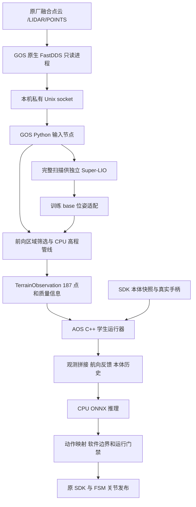

# m20_heightmap_ws 与 m20_student_deploy 接手上下文

整理日期：2026-10-28，时区 Asia/Shanghai。适用于继续维护 M20 高程感知、学生模型导出和 AOS/GOS 部署的人或代理。

`m20_heightmap_ws` 起步于 CPU 高程观测与原生 DDS 接入，现也包含学生 SDK 和 CTS 适配；`m20_student_deploy` 从前者及现场部署复制而来，负责持续维护学生模型发布和运行链路。两者有大量相同实现，但有各自的 Git 历史、模型与启动入口，不能当作可整目录互相覆盖的副本。训练来源在相邻的 `rl_training`。

**最近收据记录的状态：CTS v10 的 model_1000 已完成部署并进入过策略控制，随后因 nominal 目标超出软件关节位置范围退出；用户要求暂停后，自研 SDK 已停止，感知保留。** 这不是持续行走或楼梯验收通过。本文本轮只核对本地源码与已有收据，没有登录板端复查实时状态。

## 1. 工作区与依据

三个目录位于 `/home/ubuntu/cyq_shixi_projects/` 下：

| 工作区 | 职责及应从哪里读起 |
| --- | --- |
| [`rl_training`](../README.md) | Isaac Lab 训练、蒸馏、MuJoCo 验证和 checkpoint 来源；CTS 说明见 [`m20_cts.md`](m20_cts.md) |
| [`m20_heightmap_ws`](../../m20_heightmap_ws/README.md) | 原生点云接入、独立 LIO、坐标适配、CPU 高程、调试查看器，以及兼容 v0/v1 的部署链 |
| [`m20_student_deploy`](../../m20_student_deploy/README.md) | 学生/CTS 模型契约、导出、候选打包、两板离线验收和 SDK 运行；CTS 说明见 [`CTS_DEPLOYMENT.md`](../../m20_student_deploy/docs/CTS_DEPLOYMENT.md) |

本轮读取的源码基点分别为 `m20_heightmap_ws@ece13af`、`m20_student_deploy@494cd48`。训练仓库有大量本地改动，本文以当前文件和具体实验来源为据，不用训练仓库 HEAD 代替工作树身份。

两份部署仓库的 `contract.py`、`runtime.py`、`estimator.py`、`cts.py`、`student_policy_runner.hpp`、`cts_observation.hpp`、`cts_execution.hpp`，以及 `deploy/heightmap_v1.json`、`deploy/robot.json`，本轮逐文件读取比较一致。**启动 wrapper 存在有意差异**：高程工作区入口接受 v0/v1；学生部署工作区入口仅接受 v1，并对非 CTS 模型执行 v3.5 专用验证。维护共享实现时逐项比较补丁，保留各自适用范围。

本文相邻工作区链接需要上述目录并排存在；`logs/evaluation/` 和多数 `evidence/` 是本地证据，普通源码检出不一定包含。

## 2. 最近部署状态与时间顺序

| 阶段 | 已记录事实 | 接手时的含义 |
| --- | --- | --- |
| 10 月 17 日 student-v3 | 10500 权重试验；早期地形大量全未知，后续修复去畸变、时序与前向扇形处理 | 历史楼梯失败涉及感知和策略，不足以归结为一个原因 |
| 10 月 19 日 student-v3.5 | 独立 release 使用 model_2000，完成固定输入 ARM 数值验收 | README 中的 v3.5 模型和独立路径是该阶段记录 |
| 10 月 28 日 CTS v8 | 原运行根模型槽位曾切换到 model_6500 | 已被后续 model_1000 替换，不能仅比较迭代数字判断新旧 |
| 10 月 28 日地图扩边 | 扩大真实采集、拟合和缓存支持域；模型查询仍为原 187 点 | 支持域扩大不保证真实缺测消失，也没有改变策略输入 ABI |
| 10 月 28 日 CTS v10 | 从 continuous_motion_v10 run 导出 model_1000，实际 AOS ARM 对拍及运行加载有收据 | 模型选择固定到该次部署来源，不随训练目录自动更新 |
| 随后的 no-HOLD/手柄更新 | 更新调度恢复语义和手柄范围；实际进入 `standup_state → rl_control`，随后报 `CTS nominal target outside software position limits` | 最终退出原因是目标越过软件位置盒，不能继续写成周期 HOLD |
| **10 月 28 日 17:11 停止收据** | `user_requested_stop=true`，`sdk_remaining_pids=[]`；报告记录感知保留 | 最近已核对记录为自研 SDK 停止；后续要重新读取现场状态 |

优先依据：[`nohold 最终报告`](../logs/evaluation/cts_nohold_speed_20261028/report.txt)、[`停止收据`](../logs/evaluation/cts_nohold_speed_20261028/stopped_by_user.json)。之前的 [`model_1000 启动报告`](../logs/evaluation/cts_latest_policy_20261028/report.md) 只描述当时已启动的状态；两个 README 顶部的“已启动”没有覆盖更晚的停止结果。原始说明保留在原处，本文明确其时间边界。

该次 model_1000 来源见 [`plan.json`](../logs/evaluation/cts_latest_policy_20261028/plan.json)：

```text
logs/rsl_rl/deeprobotics_m20_cts/
  2026-10-28_12-44-13_840316_cts_continuous_motion_v10/model_1000.pt
```

checkpoint、TorchScript、ONNX 各有不同 SHA，不要混用。来源摘要见上述 plan，板端实际加载的 ONNX 摘要见 [`runtime_proof.json`](../logs/evaluation/cts_latest_policy_20261028/runtime_proof.json)。该次运行根记录为 `/home/user/m20_heightmap/current`，解析到 `releases/20261017_dynamic_terrain_fan_e963b7dea6e2`；它与历史 v3.5 独立 release 并非同一条路径。恢复原模型、地图或控制软件分别使用对应变更的备份清单。

## 3. 端到端数据流



- 原始大点云在 GOS 本机处理，AOS 不再作为新增大云中继。跨板使用地形、状态、IMU/位姿等小消息；AOS 预检可读点云收件凭据。
- 原生读取端使用原厂 ABI 和 `/usr/local/lib` 依赖；私有 socket 校验进程身份及 peer credentials。不能把普通 ROS 订阅能看到话题等同于原厂来源核验通过。
- 完整扫描供 LIO，地形管线使用已标定的前向区域。筛选不伪造点时间，不把被遮挡区域补成地面。
- 实际策略路径在 C++ SDK 进程内拼观测并推理。Python `aos_adapter` 是可选外接接口，不能因它存在就假定它是现场推理进程。
- GOS 不加载策略网络、不发布关节指令。AOS 的 SDK `Start()` 包含初始化命令，`Stop()` 会发送阻尼，均不能用作无动作探针。

链路和进程说明见 [`REAL_ROBOT_STEPS.md`](../../m20_heightmap_ws/docs/REAL_ROBOT_STEPS.md) 与 [`NATIVE_DDS_20261015.md`](../../m20_heightmap_ws/docs/NATIVE_DDS_20261015.md)；其中带日期的设备地址和运行结论属于历史记录。

## 4. 高程与时间的关键语义

模型使用以训练 `base_link` 为原点、XY 随 yaw、Z 沿重力竖直方向的 `base_yaw` 网格。坐标转换只在明确入口执行一次；ROS/部署四元数为 xyzw，不能直接套用训练内部 wxyz。雷达 frame 字符串本身不足以判断点是否已经被原厂转换到机体系。

高程输入为：

```text
h = clip(base_z_query - terrain_z - 0.5, -1, 1)
unknown: height = validity = confidence = 0
```

地面升高会使 h 下降。h=0 单独不能证明平地，必须同时读 validity。置信度是可审计的工程质量分数，不是已标定的安全概率。

管线先校验原始字段、时间、量程和自体区域，再用插值位姿去畸变，按格做稳健局部平面拟合。点数、二维分布、斜率、残差、外推距离和多层歧义都会影响有效性。v1 在有限窗口中按格选择最新有效来源，查询时重投影；墙面/多层矛盾会屏蔽更旧高度，避免旧平地重新出现。没有跨未知区域填洞。

三种时间必须区分：点的真实采集时间、查询位姿时间、消息到达/发布时间。`TerrainObservation.header.stamp` 是查询时间；每格按实际拟合支持点计龄，重复发布不能续命。AOS 还需计入运输和等待时间。原始 GOS monotonic 与 AOS monotonic 不能直接相减。

扩边字段 `estimator.map_capture_padding_m` 同时影响预筛、拟合中心、Patch 源布局和可见性。**采集网格与固定策略查询网格已经分离**，不会因缓存扩大而扩大模型输入。具体参数读现场 runtime 和 [`DEPLOYMENT_PARAMETERS.md`](../../m20_heightmap_ws/docs/DEPLOYMENT_PARAMETERS.md)，几何与误差传播见 [`ALGORITHM.md`](../../m20_heightmap_ws/docs/ALGORITHM.md)。真实测量不重复叠加训练随机噪声、丢帧或人为延迟。

## 5. 观测、历史与模型接口

### 固定的观测布局

网格由 11 个升序 Y 行、17 个升序 X 列组成，按行展开；各通道整段排列。

| v1/当前 CTS obs 切片 | 内容 |
| --- | --- |
| `[0:57]` | 当前本体：gyro3、projected gravity3、有效命令3、相对关节位置16、关节速度16、previous action16 |
| `[57:244]` | height187 |
| `[244:431]` | validity187 |
| `[431:618]` | confidence187 |
| `[618:789]` | 过去三帧本体，每帧57维，由旧到新 |

历史总长度包含当前帧；reset 后过去帧补零，每个策略步只提交一次。轮子的相对位置槽置零；previous action 保存实际已发布的归一化动作，不是 PD 目标，也不是未发布的推理候选。地形过期后的重算沿用同一原始命令及反馈前状态，不重复推进历史。

消息额外携带 schema、profile、session/sequence、geometry hash、commissioning 状态和每格 variance/age；后两者用于质量和时效处理，不追加到模型输入。ABI 以 [`TerrainObservation.msg`](../../m20_student_deploy/src/m20_heightmap_msgs/msg/TerrainObservation.msg)、[`contract.py`](../../m20_student_deploy/src/m20_heightmap/m20_heightmap/contract.py) 和模型 sidecar 为准。

### 策略版本与 profile 的区别

| 模型 | 模型接口及区别 |
| --- | --- |
| 原 student-v0 | 618维，无过去本体历史；profile v0 |
| 原 v1、v3、v3.5 | 当前四帧配置为789维；v3.5 仍为 ELU MLP，不把教师 residual 网络带到实机 |
| v3.5 发布族 | `deployment_family=m20_student_v3_5`；必须执行保存的 `legacy_v1_v3_5` 传感器航向反馈 |
| 当前 CTS 发布族 | `deployment_family=m20_cts_student`；静态 FP32 输入 `obs[1,789]`、`raw_command[1,3]`，输出 `actions[1,16]` |

`v1` 是沿用的观测/profile/模型槽位名称，不能据此判断里面是旧 v1、v3.5 还是 CTS。应同时检查部署族、CTS 版本、契约和模型摘要。

CTS 导出的是完整学生 encoder 加共享 decoder，教师、critic、优化器和训练 retention 数据不进入部署。`raw_command` 必须在航向反馈前独立保存，不能从 `obs[6:9]` 倒推；原始零命令时有效 yaw 仍可能非零。GOS 地形消息不需要承载命令。

当前 Python 部署适配器显式接受 CTS v2/v8/v10。训练说明已推进到 v12，**训练版本更新不等于部署白名单已支持**；仅因外部维度相同就替换新模型会绕过语义核验。入口见 [`cts.py`](../../m20_student_deploy/src/m20_heightmap/m20_heightmap/cts.py)。

旧 v3.5 固定样本 ARM 数值误差曾通过 FP64 线性计算、线性输出回 FP32 再执行 ELU 处理；外部仍为 FP32。CTS 使用双输入分支图和 FP32 导出，不能套用旧单输入 MLP 的转换。对拍必须覆盖实际 ARM 后端和真实入口，ONNX checker 或 x86 通过不足以代替。

## 6. CTS 执行控制与当前退出原因

CTS 网络输出的是 nominal action。训练中的完整 Safe/Quiet 执行还包含落脚控制，因此 ONNX 文件不能独自代表完整机器人控制器。

- `landing` 及缺省模式要求经过验证的真实接触、运动学、时钟和执行器反馈。相关 CPU C++ 公式与调用链已实现，但实测硬件 binding 尚未验收，门禁仍阻拦不完整链路。
- 现场显式选择 `aos.cts_execution_mode=nominal_pd`，使用 nominal action 和原 PD，跳过触地修正及落脚记忆。这是执行消融，不能描述为完整落脚控制已部署。
- 当前 `policy.hold_enabled=false` 仅适用于 CTS nominal_pd。坏图降 unknown、好图恢复；调度过期丢候选，下一新鲜周期继续，不补跑虚拟子步。该开关不解除有限值、本体/姿态、关节边界、控制权、退出和发布前时限检查。
- nominal 更新与 SDK 子步分别推进，上一动作和发布缓存必须对应真实发布；将日志事件数量直接当作电机执行数量会误判。

最近实体试运行已进入策略，退出原因为 `CTS nominal target outside software position limits`，来源见 [`report.txt`](../logs/evaluation/cts_nohold_speed_20261028/report.txt)。对应实现位于 [`student_control_core.hpp`](../../m20_student_deploy/src/m20_student_sdk/plugin/student_control_core.hpp)。后续应先对齐该周期的 raw/nominal action、映射后目标、关节名与生效边界，再判定来源；现有收据没有证明根因已解决，不能据此直接放宽限位。

触地估计工具目前属于诊断，`contact_valid` 保持 false。离地/承载的对照采样和独立依据尚有缺口，不能把原厂缺失字段填零当作有效触地。完整接口及专项步骤见两仓库的 `docs/CTS_DEPLOYMENT.md`。

## 7. 关键代码定位

以下路径相对于部署工作区；共享实现本轮已比较，但后续仍需重新核对。

| 路径 | 接手用途 |
| --- | --- |
| `src/m20_native_inputs/`、`src/m20_student_sdk/plugin/native_cloud_reader.cpp` | 原生 DDS 与 ROS 输入边界、原厂来源身份 |
| `src/m20_heightmap/m20_heightmap/native_inputs.py`、`base_pose.py` | 点云/IMU 接入及训练 base 位姿 |
| 同目录 `runtime.py`、`terrain_worker.py`、`estimator.py` | `Pipeline`、独立 spawn 拟合 worker、`ElevationMapper` 与 Patch |
| 同目录 `ros_nodes.py`、`receiver.py`、`contract.py`、`cts.py` | GOS mapper、可选 AOS adapter、接收/拼接与模型契约 |
| `src/m20_heightmap_msgs/msg/` | 地形及可选策略观测 ABI |
| `src/m20_student_sdk/plugin/student_policy_runner.hpp`、`cts_observation.hpp` | 实际 C++ 拼接、反馈、历史和推理路径 |
| 同目录 `student_control_core.hpp`、`cts_worker_scheduling.hpp` | nominal 子步控制、发布边界与 worker 调度 |
| 同目录 `cts_execution.hpp`、`cts_landing.hpp`、`cts_terrain_memory.hpp`、`cts_feedback.hpp` | 完整落脚实现、地形记忆及反馈契约 |
| `src/m20_student_sdk/vendor/main.cpp` 与 `vendor/state_machine/` | SDK/FSM 初始化、交接、控制和退出 |
| `scripts/prepare_*_release.py`、`package_release.py`、`stage_board_release.py` | 导出、候选打包与目标板独立路径准备 |
| `scripts/operator_start_gos.sh`、`operator_start_aos.sh`、`operator_commission.py` | 感知/运控入口及现场确认 |
| 高程工作区 `scripts/view_lidar_debug.py`、`stream_lidar_debug.py` | 桌面只读实时查看和 JSONL 回放 |

训练侧优先读 `source/rl_training/task_support/cts/`、`task_support/student_v3_5/`，以及 [`m20_cts.md`](m20_cts.md)、[`m20_student_v3_5.md`](m20_student_v3_5.md)。实机 nominal_pd 与带完整落脚控制的 MuJoCo 表现不能直接等同。

## 8. 配置权威与现场身份

| 对象 | 应读取的来源 |
| --- | --- |
| 现场感知与执行模式 | 两板实际 release 下 `runtime/heightmap_v1.local.json`；模板不会覆盖已有 runtime |
| 模型/输入语义 | 实际 `models/v1` 指向的 bundle、`observation_contract.json` 及导出/数值元数据 |
| 动作与关节 | 当前 `deploy/robot.json`；关节名、映射、默认姿态、增益、目标裁剪和软件边界一起读 |
| 安装几何与 LIO | `deploy/site.json`、`deploy/gos_lio.yaml` 及当前内容绑定 |
| 现场确认 | 绑定当前 boot、profile 和配置内容的 commissioning 收据 |
| 实际加载版本 | `/proc/<pid>/exe`、cwd、environ、Python import 路径、日志与 trace 身份 |

可调数值继续由这些配置及原参数台账维护，本文不另建一份速度、阈值或资源预算表。SDK API 已转换过方向/零偏的读写不可再套 raw 转换；策略关节顺序、SDK16 顺序和原始电机坐标需分清。

修改模型、robot、安装配置或高程 runtime 会影响内容绑定；不可改写旧 commissioning 假装重新确认。只改 `src/` 也不保证已安装的 Python 包更新，两板均需核对实际 import 的 `install/.../m20_heightmap`。模板的 `calibration_confirmed=false` 与现场 runtime 的已确认状态是两个对象。

地址与跳板以本次网络和板卡角色/序列号为准。旧文档出现过直连、旧狗 NVIDIA 跳板和 1515/AOS 跳板，不能沿用某个历史 IP 判断身份。秘密从授权入口读取，不写入脚本、命令参数或文档。

## 9. 常用工作流与核验入口

下面是接手时可复用的入口索引；本轮没有执行导出、构建、测试或真机启动。训练、编译、推理验证前先按实时余量核算资源，仿真验证需有明确上限且不更新优化器。长期训练和续训由用户自行启动。

### 新 CTS 候选

在 `m20_student_deploy`，使用匹配的训练 Python 环境：

```bash
python scripts/prepare_cts_release.py \
  --checkpoint /absolute/path/to/model_N.pt \
  --training /absolute/path/to/rl_training \
  --output /absolute/path/to/new_candidate
```

输出必须是不存在的新目录。它不继承旧 runtime、commissioning 或启动许可。先核对 CTS 版本和完整执行契约，再进入打包/两板新路径准备；传输使用 `safepush`，不整目录覆盖 current。v3.5 使用 `prepare_v35_release.py`，不要串用。

### 无电机模型与地图检查

```bash
# 在候选工作区；需要相应本地 Python 依赖
python scripts/validate_cts_bundle.py --model-dir models/v1
python scripts/offline_cts.py --model-dir models/v1

# 在已构建的 AOS release，使用实际 ARM C++ 探针
source scripts/board_env.sh
python3 scripts/offline_cts.py --model-dir models/v1 \
  --probe install/m20_student_sdk/lib/m20_student_sdk/student_onnx_probe

# 在板端仅验证地图支持域，不加载模型或 SDK
python3 scripts/check_map_capture.py \
  --config runtime/heightmap_v1.local.json --output runtime/capture_check_NEW.json
```

GOS 可用 `validate_cts_bundle.py --metadata-only` 核对模型摘要，不加载网络。`offline_board_models.py` 按模型族分流；`accept_offline_release.py` 只签软件离线验收，不授予现场运动许可。`STAGED_NOT_ACCEPTED.txt` 存在时入口会拦截，不能手工删除 marker 代替验收。

板端构建从 `scripts/build_board.sh` 进入：识别 AOS/GOS、使用 Foxy、顺序单任务编译，并依赖本机原厂 SDK、CPU ORT 和 native FastDDS。x86 `build/install` 不可复制到 ARM 当作已构建；移动工作区后也要检查 colcon 是否残留旧绝对路径。

### 现场启动关系

先读 current、实际进程和收据，避免重复实例。只有重新满足当前现场条件后，才依次核验纯感知、离线模型、live preflight、两板 commissioning 和原交互入口。

GOS 入口为 `operator_start_gos.sh v1`；AOS 在板内 tmux 使用 `operator_start_aos.sh v1`，显式 `supported-init` 是原有受限初始化路径。它仍校验来源、配置、唯一发布者和现场确认，不能当作通用跳过检查选项。最近收据已记录用户要求暂停，不能依据本节自行恢复控制。

### 只读点云查看

高程工作区 `view_lidar_debug.py` 通过已核验的 GOS SSH 入口显示完整/前向点云与高程，支持本机身/前雷达原点、不同质量图层、明确标注来源的候选旁路和离线回放。显示采样不是生产原始流无损录制；采样快照与严格实时效期也不同。关闭查看器停止本次采集，不自动停止独立感知服务。

## 10. 历史问题及接手判据

| 现象 | 已知背景或真因 | 应如何判断 |
| --- | --- | --- |
| 改了文件但现场没变 | source/install、两仓库、current/release 或旧进程存在差异 | 同时读真实 exe/import 路径、哈希、环境和新日志 |
| 地形大量 unknown、撞阶后才抬腿 | 早期确有点时间、位姿/去畸变、前向处理及历史支持域问题；策略也存在未解疑点 | 对齐同周期点云、位姿、地形和 full789；静态有效不能代替动态验收 |
| 扩边后仍缺测 | 缓存不能创造未观测表面；几何支持、遮挡和过期仍生效 | 看实际支持和格龄，不以有效格数量直接宣称精度提升 |
| 原先周期 HOLD | 旧记录含真实 worker 延迟及 phase 恢复问题，后续已修改调度/恢复 | 区分旧 HOLD、候选丢弃与最终软件关节盒 fault；保留真实发布时间 |
| 最新策略退出 | nominal 目标越过软件位置盒，随后退出并按用户要求停 SDK | 查 fault 对应目标与边界；不是“关闭 HOLD 后已稳定” |
| 模型能导出但拒绝加载 | 版本、静态双输入、元数据、控制契约或几何不一致 | 同时验证 bundle、C++ 实际入口和 ARM 数值，不能只看文件维度 |
| 初始化通过但后面没接管 | SDK 模式、本体数据、手柄/FSM 状态和物理反馈是不同事实 | 读真实状态转换与反馈，不能把预热或 DDS 发布返回当作实体动作成功 |
| 新模型读取因磁盘失败 | 日志预算门槛真实拦截过根分区不足 | 最近记录改用已有数据分区存新 trace，保留原日志和空间门槛 |

较早知识库还有另一条 2067 维雷达 encoder 部署线，不能把它的维度、话题或 smoke 元数据规则照搬到当前 789+3 CTS；能借鉴的是静态 ABI、元数据与后端对拍必须共同核验。colcon 移动路径的旧案例同样属于机理提示，修复前仍需核验当前包索引。

## 11. 验证边界与继续接手

已有报告记录了 CPU/实际 ARM 固定输入对拍、隔离的真实 C++ runner 回放、地图支持域反例和板端收件。最新 no-HOLD 报告记录软件测试及实体进入策略；这些都是对应历史运行的证据，本轮未复跑。trace 存在显式 dropped，不能称整场无损；异构 family 复核也有缺档。

尚未形成通过结论的项目包括：持续实体行走与楼梯成功率、动态提前抬腿、地图独立真值精度、完整 landing 硬件反馈、持续共载实时性，以及最新 nominal 关节目标越界的根因和修复。感知与模型接口测试通过不能替代这些结论。

继续接手时按以下事件推进：

1. 读取最新停止/运行收据，再核对现场 current、boot、模型与进程，确认暂停状态是否仍适用。
2. 固定本次要用的 checkpoint、bundle、代码和现场配置；不要让“最新模型”随目录增长而漂移。
3. 针对最新位置盒 fault，先保存有界且固定的日志切片，对齐关节名、动作和目标映射，确认问题来源；不自动启动 SDK 重试。
4. 新模型尤其是训练 v12，先核验部署版本和语义支持，再做 CPU、ARM 和无电机运行器验证。
5. 只有相应现场条件和当前授权满足后，才走原 commissioning 与交互控制入口。物理动作结论单独验收。

正式实验报告、图表、轨迹和验证收据写入 `rl_training/logs/evaluation/<实验名>/`；本文只维护架构、入口、版本关系和接手边界。临时分析放项目外，保留运行输入、checkpoint 和正式日志，不恢复长期训练、不清理他人数据。

可复制给下一窗口的任务背景：

> 本项目链路为 GOS 原生点云＋独立 LIO＋CPU 高程，经 TerrainObservation 到 AOS C++ 学生运行器。当前观测沿用 v1/789，CTS 另需独立 raw_command3，部署完整 student encoder＋decoder。两仓库共享大量代码但启动范围不同。最近记录使用 CTS v10 model_1000、nominal_pd、非锁存恢复；实体进入策略后因 nominal 目标超软件关节位置盒退出，用户暂停，自研 SDK 已停、感知保留。先核对最新现场身份与停止收据，定位动作/目标/限位，不自动重启或放宽门槛。完整 landing 硬件接触未验收，训练 v12 也未因外部 ABI 相同而自动获得当前部署适配支持。
