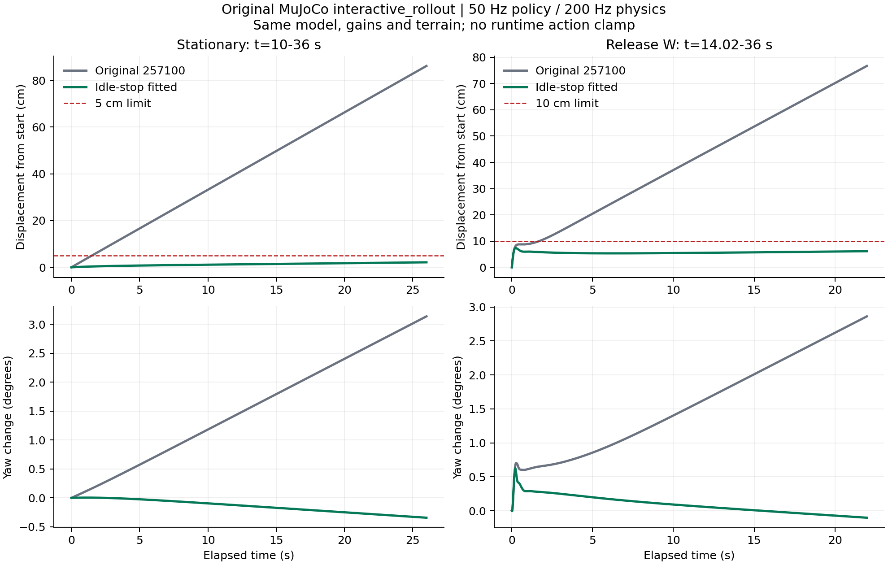

# M20 257100：驻足与释放 W 后停车修复

交付模型：[`model_257100_idle_stop.pt`](../../logs/rsl_rl/deeprobotics_m20_idle_stop_v1/2026-10-12_idle_stop_distilled_257100/model_257100_idle_stop.pt)。原始 `model_257100.pt` 保持不变，原 MuJoCo 部署代码、观测、PD 增益和地形均保持不变。

## 实测结果

同一原始 `interactive_rollout`，Z=0s、C=6s，50Hz 策略、200Hz 物理。W 从8s持续到14s再释放；每例36s。只替换窗口、键盘输入源和墙钟等待，实际物理与控制均执行。

| 指标 | 原257100 | 修复模型 |
|---|---:|---:|
| 驻足10–36s最大位置偏移 | 86.15cm | 2.13cm |
| 驻足最后10s路径速度 | 33.11mm/s | 0.63mm/s |
| 驻足偏航最大变化 | 3.138° | 0.343° |
| 释放W后14.02–36s最大位置偏移 | 76.73cm | 7.32cm |
| 停车最后10s路径速度 | 33.11mm/s | 0.61mm/s |
| 停车前8.02–14.02s实际前进距离 | 3.657m | 3.595m |
| 到达楼梯出口x=6.6m时间 | 18.56s | 18.68s |
| 触地后40ms力峰值的事件均值 | 402.1N | 444.6N |
| 楼梯累计轮心平动比能量/前進米 | 9.149J/kg/m | 9.193J/kg/m |

固定三例全部通过预先设定的工程判据，均未跌倒。楼梯平均触地冲击增加约10.6%，累计能量增加约0.48%，均在原定15%保持线内。这是一次固定几何的实测，未作为全地形静音认证。



[停车前后并排视频](stop_before_after.mp4)：直接渲染实际物理回放保存的状态，摄像机固定在各自停车起点；视频不是第二次物理实验。

[新录MuJoCo完整对比视频](fresh_comparison_video/m20_257100_vs_idle_stop_mujoco.mp4)：重新运行两模型的闭环物理并同步捕获画面，原速70秒，依次展示驻足、前进后停车、楼梯；左原版、右修复版。[录制说明与两条训练路径的证据](fresh_comparison_video/README.md)同时提供各模型独立视频。

## 补充检查与剩余问题

低速前进0.35m/s、倒车−0.7m/s、原地转弯0.6rad/s后的停车均通过同样位移、末段速度和1°偏航检查。实际位移分别约4.15cm、7.66cm、1.94cm；原策略分别约74.0cm、61.9cm、72.3cm。运动阶段实际进度也与原策略比较，排除了“没动所以能停住”。

横移0.5m/s后，停车最大位移4.92cm、末段速度0.558mm/s，但释放命令后约0.34s出现3.045°偏航峰值，终点偏移2.433°，未通过额外1°线。最后10s反向缓慢变化0.167°；不能称完全无偏航，也不是持续同方向转圈。基线同例最大偏航4.402°。这项仍待修复，不能把补充四例报为全部通过。

本轮未修后腿下楼触地、四轮载荷均衡、坡上停车；未执行真机验证。下楼/上楼只用作原移动能力与落地能量的回退检查。

## 修复方法与接线

原 actor 在零命令时仍给出非零轮速度目标。初始受控 PPO 微调不能稳定满足驻足判据，因此未采用该候选。最终使用原部署产生的实际观测，做CPU监督蒸馏：平地零命令的四轮目标设为零，其余样本与腿部输出以原257100为保留目标；补充 previous_action、轮速度向零收敛的监督输入。只允许原MLP末两层更新，前两层与 log_std 保持逐位相同。

仍是原生244→512→256→128→16的ELU actor，无新增输入、部署分支、速度反馈控制器或运行时动作裁剪。腿部输出是保留目标，不宣称在所有输入上严格不变。训练样本上腿部动作RMS变化约0.00669，移动全部动作RMS变化约0.00942；性能结论以真实物理回测为准。

训练入口是 [`finetune_idle_stop_wheels.py`](../../scripts/tools/finetune_idle_stop_wheels.py)，其中调用 [`idle_mask`](../../source/rl_training/m20_quiet/idle_stop.py)。掩码明确排除命令非零、非平地、无效及高度裁剪饱和值；实际速度或接触不能关闭停车目标。

## 使用

在项目根目录执行；按Z站起、C进入策略，W前进、释放W停车：

```bash
/home/ubuntu/miniconda3/envs/m20_wzh/bin/python deploy/deploy_mujoco/deploy_mujoco.py \
  --checkpoint logs/rsl_rl/deeprobotics_m20_idle_stop_v1/2026-10-12_idle_stop_distilled_257100/model_257100_idle_stop.pt \
  --model '/home/ubuntu/桌面/m20_1/M20_perception_Lidar_rl_2/M20_perception_Lidar_rl/deep_robotics_model/M20/mjcf/M20.xml' \
  --terrain-xml deploy/deploy_mujoco/terrains/all_terrain.xml \
  --viewer --quiet-landing
```

可复现训练（CPU、单线程、种子42、8000步；输出路径须不存在）：

```bash
OPENBLAS_NUM_THREADS=1 OMP_NUM_THREADS=1 MKL_NUM_THREADS=1 CUDA_VISIBLE_DEVICES='' \
/home/ubuntu/miniconda3/envs/m20_wzh/bin/python scripts/tools/finetune_idle_stop_wheels.py \
  --checkpoint logs/rsl_rl/deeprobotics_m20_quiet_landing_v1/2026-10-10_00-48-58_quiet_landing_v1/model_257100.pt \
  --input_manifest docs/m20_idle_stop_257100_20261012/reproduction_manifest.json \
  --output /tmp/m20_idle_stop_reproduced.pt
```

独立脚本已重现全部 actor 张量逐位一致，见 `reproduction.json`。模型中的iter仍为来源257100；本次8000步是监督拟合步数，不是新增PPO迭代号。优化器旧动量已清空。后续训练用 `--init_actor_from` 明确初始化此 actor；原 critic/reference不代表新PPO过程已验收。

复跑固定判据（生成新标签，不覆盖证据）：

```bash
/home/ubuntu/miniconda3/envs/m20_wzh/bin/python docs/m20_idle_stop_257100_20261012/run_suite.py \
  logs/rsl_rl/deeprobotics_m20_idle_stop_v1/2026-10-12_idle_stop_distilled_257100/model_257100_idle_stop.pt reproduced_check
/home/ubuntu/miniconda3/envs/m20_wzh/bin/python docs/m20_idle_stop_257100_20261012/judge.py reproduced_check
```

## 证据

`verdict.json` 是固定三例判据，`extra_verdict.json` 包含额外四例与未通过项；`criteria.json`保留原冻结数值，`instrument_sources.json`补齐平地XML和地形加载器的源哈希。`evaluations/`含原始NPZ、操作身份收据与日志，`inputs/`含复现所需实际观测。

模型SHA256：`0e6d0c93560b5a3f7ce9219c7b6a0cea84bd4a2d3f5dba33c02d79f7d4eb5f34`。原模型SHA256：`368fa6287d3fc5e999b4ad596ad9f84be23f25d72bbd861236ec535a66b51c1c`。

独立复核如实记录实际 family=Codex，异构family缺档；不把同 family 复核包装成异构验收。首轮检查发现高度饱和假平地；第二轮发现停车未行驶、来回漂移和身份哈希的假绿。所有已发现仪器漏洞均加反例关闭，额外横移偏航仍明确报未通过。

机器级附带检查：`company-rules check` 的项目可机检条款未发现问题；全机分发检查因 `.gnupg` 权限退出1，另有11个外部检出跳过、8处未建，现存分发不一致为0。这些未作修复，也不计为策略测试通过。完整分层结果见 `test_summary.json`。知识方法条目已以隔离提交 `996e3e21` 写回hub/main。
