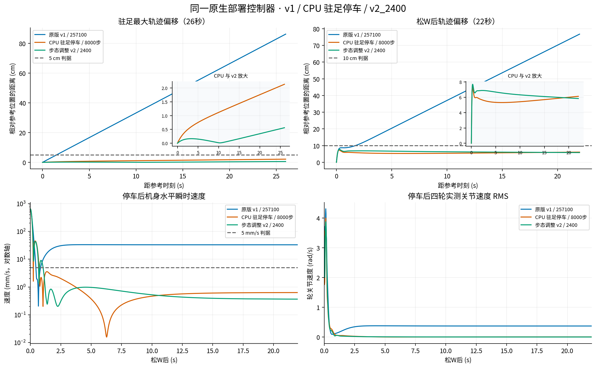
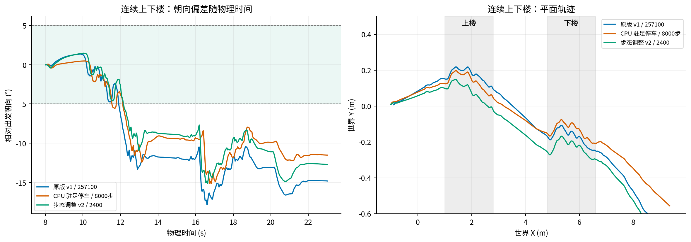
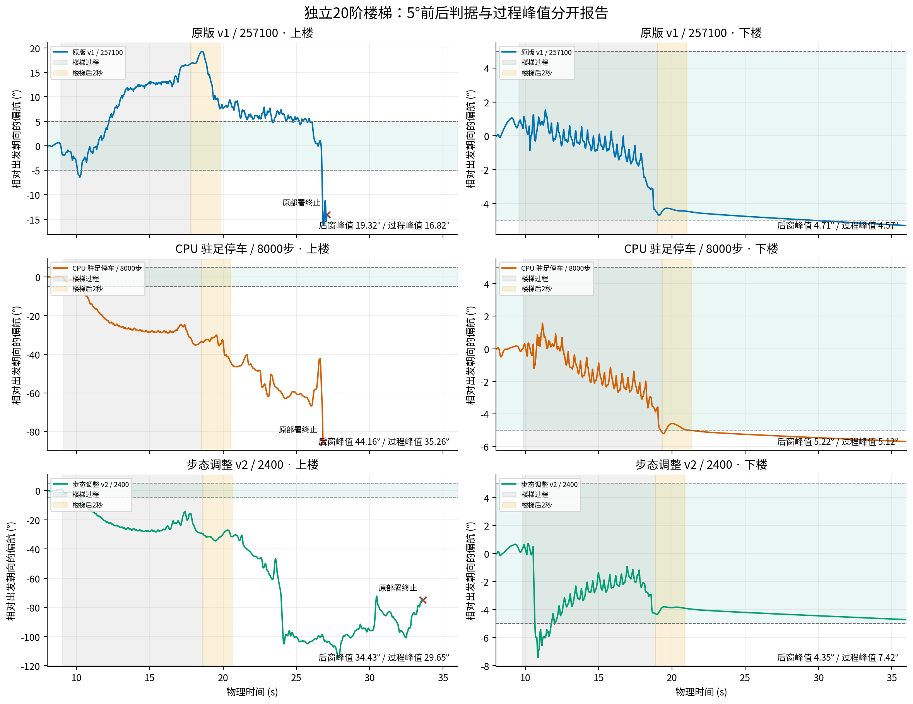

# M20 三模型 MuJoCo 对照：v1 / CPU 驻足停车 / 步态调整 v2_2400

本轮重新执行了 **15 次带物理的闭环 MuJoCo 测试**，每个模型各跑驻足、前进后停车、连续上下楼、独立20阶上楼、独立20阶下楼。v2 在开跑前固定为 **model_2400.pt**；后续 checkpoint 没有混入本次结果。

**结论：v2 驻足最稳，两种修复版均改善停车；CPU版停车收敛更快。楼梯朝向仍未全面达到5°，20阶上楼的朝向回归尤其明显，不能据此宣布步态修复完成。** 本轮完成评估与录制，未启动新训练。

## 视频与原始数据

[完整三画面对比视频（原速128秒）](m20_v1_cpu_v2_2400_mujoco_compare.mp4)，**左：原版；中：CPU修复；右：v2_2400**。

|片段|时长|原始物理时间|
|---|---:|---|
|[驻足](idle_compare.mp4)|26秒|10–36秒|
|[前进后停车](move_stop_compare.mp4)|30秒|6–36秒；8秒按W，14秒松W|
|[连续上下楼](combined_stairs_compare.mp4)|16秒|8–24秒；上/下各6阶|
|[独立上楼](ascent_compare.mp4)|28秒|8–36秒；20阶|
|[独立下楼](descent_compare.mp4)|28秒|8–36秒；20阶|

各画面按同一物理时间同步，无加速或按楼梯进度重定时。上楼提前终止的模型保留最后真实画面，并用红条注明“已终止，此后定格”；定格时间不算继续站立成功。每次测试目录的 `live.mp4` 是物理运行时直接录制的独立视频，三画面仅做拼接。

[完整指标 JSON](metrics.json)、[CSV 对比表](comparison.csv)、[验收规则与模型指纹](criteria.json)、[移动能力判据来源](motion_criteria_addendum.json)、[动作/模型/视频核验记录](verification.json)、[视频拼接清单](video_manifest.json)。每个 `模型_场景` 目录保留 `state.npz`、`control.npz`、`control_quiet.npz`、`receipt.json` 和运行日志。

## 驻足与停车

驻足从10秒开始量26秒，记录相对参考位置的**最大位移**，不是仅看终点净位移。

|模型|最大位移 cm|末10秒路径速度 mm/s|最大偏航 °|停车稳定时间 s|判定|
|---|---:|---:|---:|---:|---|
|原版 v1|86.15|33.105|3.138|—|未通过|
|CPU 驻足停车|2.13|0.632|0.343|—|通过|
|v2 / 2400|0.56|0.362|0.057|—|通过|

停车从14.02秒开始量至36秒。稳定时间要求水平速度≤5 mm/s、绝对偏航角速度≤0.05 rad/s，连续保持1秒；表中时间是首次满足这段连续窗口的起点。

|模型|最大位移 cm|末10秒路径速度 mm/s|最大偏航 °|停车稳定时间 s|判定|
|---|---:|---:|---:|---:|---|
|原版 v1|76.73|33.108|2.862|未在窗口内稳定|未通过|
|CPU 驻足停车|7.32|0.609|0.624|0.72|通过|
|v2 / 2400|7.70|0.385|0.564|1.06|通过|

松W前6秒实际前向进度：v1 **3.658m**，CPU **3.596m（98.3%）**，v2 **3.673m（100.4%）**。两种修复版都保留了前进能力，停车改善不是由拒绝运动造成的。

v2 比CPU版驻足漂移更小、停车末段残余速度更低；CPU版停车最大位移略小、稳定更快。平地结果支持保留驻足停车修复，但不能代表楼梯性能。



## 楼梯朝向

朝向参考是首次前进后的机身 yaw（约8.04秒），各模型保留自己的出发朝向。入楼由最前轮接近第一阶判定；出楼要求四轮均离开最后一阶。前窗是入楼前0.5秒，后窗是完全出楼后2秒。前后两窗各自的**最大绝对偏差≤5°**才可能通过；还要求完整过楼、无越过楼梯侧边、后窗完整、整个测试无原部署跌倒终止。过程峰值单独报告。

“前后均值变化”是后窗平均朝向减前窗平均朝向，带方向符号，**不能代替最大偏差判据**。连续下楼的出发参考继承上楼前的参考，因此表中下楼后全局偏差包含上楼已产生的偏差。

### 连续上下楼，各6阶

|模型 / 楼梯段|前窗最大 °|后窗最大 °|过程最大 °|前后均值变化 °（带符号）|5°前后判据|
|---|---:|---:|---:|---:|---|
|原版 v1 / 上楼|1.34|12.17|13.34|-13.06|未通过|
|原版 v1 / 下楼|12.09|16.58|17.80|-2.55|未通过|
|CPU 驻足停车 / 上楼|0.46|9.69|12.39|-9.76|未通过|
|CPU 驻足停车 / 下楼|9.64|12.20|15.12|-1.23|未通过|
|v2 / 2400 / 上楼|1.45|9.26|10.93|-10.24|未通过|
|v2 / 2400 / 下楼|9.15|14.84|15.13|-3.51|未通过|

三者均完成上下楼并跑满36秒。v2 上楼过程峰值比原版下降，但下楼后全局偏差仍为14.84°；单段下楼的平均新增偏差为−3.51°。这两个数描述不同的量。



### 独立20阶上楼

|模型 / 楼梯段|前窗最大 °|后窗最大 °|过程最大 °|前后均值变化 °（带符号）|5°前后判据|
|---|---:|---:|---:|---:|---|
|原版 v1 / 上楼|0.65|19.32|16.82|+14.42|未通过|
|CPU 驻足停车 / 上楼|0.21|44.16|35.26|-34.91|未通过|
|v2 / 2400 / 上楼|0.82|34.43|29.65|-31.56|未通过|

三者均已爬完20阶并获得完整后窗。CPU与v2在这条长楼梯上的朝向比原版更差：CPU后窗44.16°，v2后窗34.43°，原版19.32°。

上楼后继续前进的末段需单独解释：顶部平台宽4m，前端X=16.25m。原版17.80秒完全出楼，26.20秒轮心越过平台前端，27.08秒触发原部署终止；CPU18.52秒出楼，19.76秒轮心越过侧边Y=−2m，26.82秒终止；v2 18.62秒出楼，20.14秒越过侧边，33.64秒因机身过低触发终止。最后一项的末帧仍基本直立（Rzz≈0.995），所以“终止”包含原部署的机身高度保护，不能全部描述成已经侧翻。

这些是**爬完后**的边界越出与终止，不应归结为“三者都无法爬上20阶”。楼梯后2秒的朝向已经超标，判断朝向失败不依赖末段是否继续跌倒。按冻结规则，三个上楼案例不用于宣称完整回合落地冲击改善。

### 独立20阶下楼

|模型 / 楼梯段|前窗最大 °|后窗最大 °|过程最大 °|前后均值变化 °（带符号）|5°前后判据|
|---|---:|---:|---:|---:|---|
|原版 v1 / 下楼|1.06|4.71|4.57|-5.18|通过|
|CPU 驻足停车 / 下楼|0.17|5.22|5.12|-4.87|未通过|
|v2 / 2400 / 下楼|0.65|4.35|7.42|-4.28|通过|

三者都完整下楼且未跌倒。v2 的前后两窗满足5°，但过程峰值7.42°，高于原版4.57°；CPU后窗5.22°，略超限。v2 在下楼过程中约12.5%的采样时刻超过5°，因此仍需改善过程朝向。这里的“通过”仅指冻结的出发朝向窗口判据；若看单段前后平均朝向变化，原版下楼为−5.18°，已超过5°，不能把两种定义混为一项。



## 落地冲击回归检查

统计采用已有 MuJoCo 落地事件口径：事件后的40ms接触合力峰值取事件平均；落地瞬间轮速计算单位质量动能，再按楼梯范围内的前向进度归一化。连续楼梯统计范围包含两段楼梯之间的平台。这些是仿真代理量，不是麦克风测得的声音或电机能耗。

|场景|模型|落地事件数|40ms平均峰值力 N|每米累计比动能 J/(kg·m)|相对v1：力 / 比动能|
|---|---|---:|---:|---:|---:|
|连续上下楼|原版 v1|97|402.1|9.15|基准|
|连续上下楼|CPU 驻足停车|85|444.6|9.19|+10.6% / +0.5%|
|连续上下楼|v2 / 2400|97|407.4|9.93|+1.3% / +8.6%|
|独立20阶下楼|原版 v1|133|413.1|9.89|基准|
|独立20阶下楼|CPU 驻足停车|145|402.0|11.35|-2.7% / +14.7%|
|独立20阶下楼|v2 / 2400|147|414.3|11.84|+0.3% / +19.7%|

没有出现一致的冲击改善：连续楼梯CPU平均峰值力增加10.6%，v2增加1.3%；独立下楼v2每米累计比动能增加19.7%。事件数量不同，不能把单项事件平均改善解释为整体步态更好。

## 模型来源与部署契约

- **原版 v1**：[`model_257100.pt`](/home/ubuntu/cyq_shixi_projects/rl_training/logs/rsl_rl/deeprobotics_m20_quiet_landing_v1/2026-10-10_00-48-58_quiet_landing_v1/model_257100.pt)；SHA256 `368fa6287d3fc5e999b4ad596ad9f84be23f25d72bbd861236ec535a66b51c1c`。
- **CPU 驻足停车**：[`model_257100_idle_stop.pt`](/home/ubuntu/cyq_shixi_projects/rl_training/logs/rsl_rl/deeprobotics_m20_idle_stop_v1/2026-10-12_idle_stop_distilled_257100/model_257100_idle_stop.pt)；SHA256 `0e6d0c93560b5a3f7ce9219c7b6a0cea84bd4a2d3f5dba33c02d79f7d4eb5f34`。
- **v2 / 2400**：[`model_2400.pt`](/home/ubuntu/cyq_shixi_projects/rl_training/logs/rsl_rl/deeprobotics_m20_gait_refinement_v2/2026-10-12_16-16-02_v2_idle_stop_stair_heading/model_2400.pt)；SHA256 `01df66926880c5cbe4d422640fe38ba1a65aea41e91e85bf24d45cf24e057ab1`。

CPU版来自原v1的 **8000步CPU监督拟合**，不是200轮PPO；原部署实际观测用于拟合，平地零命令四轮输出以零为目标，腿部和移动样本以原actor为保留目标。checkpoint自身的迭代字段仍是来源257100，监督步数见 `idle_stop_calibration` 元数据。

v2是用户启动的Isaac Lab PPO训练的第2400轮快照；该运行 `params/cli.yaml` 的 `init_actor_from`、`init_critic_from`、`preserve_actor_from` 均指向原v1，额外读取纠正样本 manifest。它不是直接从CPU修复checkpoint续训。本轮只读取已有checkpoint并进行MuJoCo对照。

逐张量比对确认CPU和v2的actor仅末两层参数变化，前两层及Gaussian分布参数与v1逐位一致。三者mean_std均为 **0.127396**，每维std范围 **0.070469–0.188186**；std没有归零。MuJoCo部署使用确定性的均值动作；训练中的随机采样与此评估口径是两回事。

三者都走同一 `deploy_mujoco.py::interactive_rollout`、244维观测、16维动作、原关节映射与PD、原0.3秒策略接管过渡、原通用±100动作范围，无额外航向反馈。策略50Hz、物理200Hz、视频25fps。机器人XML固定为：

```text
/home/ubuntu/桌面/m20_1/M20_perception_Lidar_rl_2/M20_perception_Lidar_rl/deep_robotics_model/M20/mjcf/M20.xml
```

5个场景均0秒站起、6秒接策略；需移动的场景8秒按W（0.7m/s，横移和转向命令为0）。上楼每阶0.17m、20阶；下楼每阶0.15m、20阶；踏深均0.30m，宽4m。所有地形、碰撞模型和物理参数均按开跑前的指纹冻结。

核验实际运行：15份视频帧数/哈希均吻合；每次50Hz控制确实执行4次 `mj_step1/mj_step2`；同场景三模型编译后的物理模型指纹一致，接管前qpos/qvel逐位相同；记录的观测重新送入对应actor，动作在float32舍入范围内一致。部分大动作的批量推理舍入误差较大时，按部署的单样本形状重算，得到逐位一致。测量器还通过了静止、净位移为零但振荡、已知稳定时刻、4°通过/8°拒绝、跌倒/绕过/未完成拒绝的正反例检查。

## 手动MuJoCo部署与复现

在项目根目录、已有 `m20_wzh` 环境中运行下面命令。三个checkpoint依次进入同一地形；每次按Esc退出后启动下一个。按Z站起，等ready后按C进入策略；按W前进，松W停车。切换楼梯时将 `all_terrain.xml` 改为 `stairs_ascent.xml` 或 `stairs_descent.xml`；平地用 `flat.xml`。

```bash
for checkpoint in \
  logs/rsl_rl/deeprobotics_m20_quiet_landing_v1/2026-10-10_00-48-58_quiet_landing_v1/model_257100.pt \
  logs/rsl_rl/deeprobotics_m20_idle_stop_v1/2026-10-12_idle_stop_distilled_257100/model_257100_idle_stop.pt \
  logs/rsl_rl/deeprobotics_m20_gait_refinement_v2/2026-10-12_16-16-02_v2_idle_stop_stair_heading/model_2400.pt
do
  CUDA_VISIBLE_DEVICES='' OMP_NUM_THREADS=1 OPENBLAS_NUM_THREADS=1 \
  /home/ubuntu/miniconda3/envs/m20_wzh/bin/python deploy/deploy_mujoco/deploy_mujoco.py \
    --checkpoint "$checkpoint" \
    --model "/home/ubuntu/桌面/m20_1/M20_perception_Lidar_rl_2/M20_perception_Lidar_rl/deep_robotics_model/M20/mjcf/M20.xml" \
    --terrain-xml deploy/deploy_mujoco/terrains/all_terrain.xml \
    --viewer --quiet-landing --stop-on-fall
done
```

[评估复现包](reproduction_bundle.zip)保存本次使用的录制/分析/拼接源码、三份冻结checkpoint、部署源码与v2运行参数；没有另建训练入口。外部机器人XML引用的资产仍需保留原位置与版本。源码与模型哈希见 [复现包清单](reproduction_bundle_manifest.json)。

完全复现需要新建输出目录，并保持本次部署源码及外部模型资产不变。示例：

```bash
unzip docs/m20_idle_stop_257100_20261012/three_model_comparison_v2_2400/reproduction_bundle.zip -d /tmp/m20_three_model_replay
/home/ubuntu/miniconda3/envs/m20_wzh/bin/python /tmp/m20_three_model_replay/prepare_replay.py \
  --output /tmp/m20_three_model_replay_results
CUDA_VISIBLE_DEVICES='' OMP_NUM_THREADS=1 MKL_NUM_THREADS=1 OPENBLAS_NUM_THREADS=1 \
  /home/ubuntu/miniconda3/envs/m20_wzh/bin/python /tmp/m20_three_model_replay/run_all.py
OPENBLAS_NUM_THREADS=1 /home/ubuntu/miniconda3/envs/m20_wzh/bin/python /tmp/m20_three_model_replay/analyze.py
CUDA_VISIBLE_DEVICES='' OMP_NUM_THREADS=1 OPENBLAS_NUM_THREADS=1 \
  /home/ubuntu/miniconda3/envs/m20_wzh/bin/python /tmp/m20_three_model_replay/finish.py verify plots tables assemble
```

`prepare_replay.py`会核对来源哈希、内存/磁盘余量并拒绝覆盖已有输出；它不会启动训练。若源码变化则拒绝沿用这份冻结实验，需另立新的对照。

本轮每个模型每个场景只运行一次确定性测试；未进行多随机种子统计、不同摩擦/坡度/扰动测试或真机部署。**建议保留驻足停车修复，先定位20阶上楼和连续楼梯的航向退化，再决定后续续训；本报告不代表后续5000轮模型的性能。**

## 交付校验

完整128秒视频已经成功逐帧解码；[打包校验记录](packaging_checks.json)包含实际解压、逐文件哈希、新输出目录准备、拒绝覆盖的执行结果。复现启动准备已执行，第二套完整15场景重跑未执行；手动部署命令仅做语法检查。正式闭环部署证据来自本轮15次原入口运行。软件版本见 [环境记录](software_versions.json)。

本轮结论已写入本地项目知识条目，并在隔离检出中提交 `24b49909`；先拉取后普通推送，Hub返回HTTP 22，远端同步未完成。额外全机检测中的12个外部仓库被跳过，`.gnupg`无法读取，这些未检查项不计入本项目MuJoCo验收。
