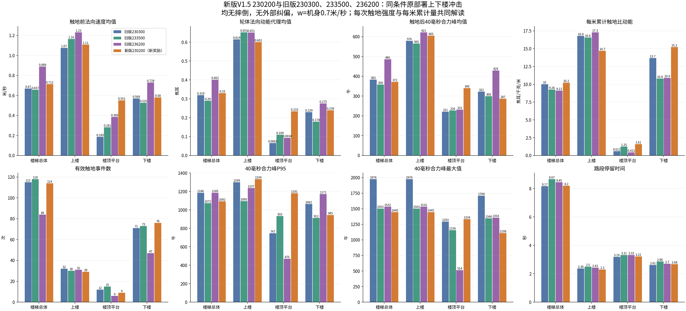
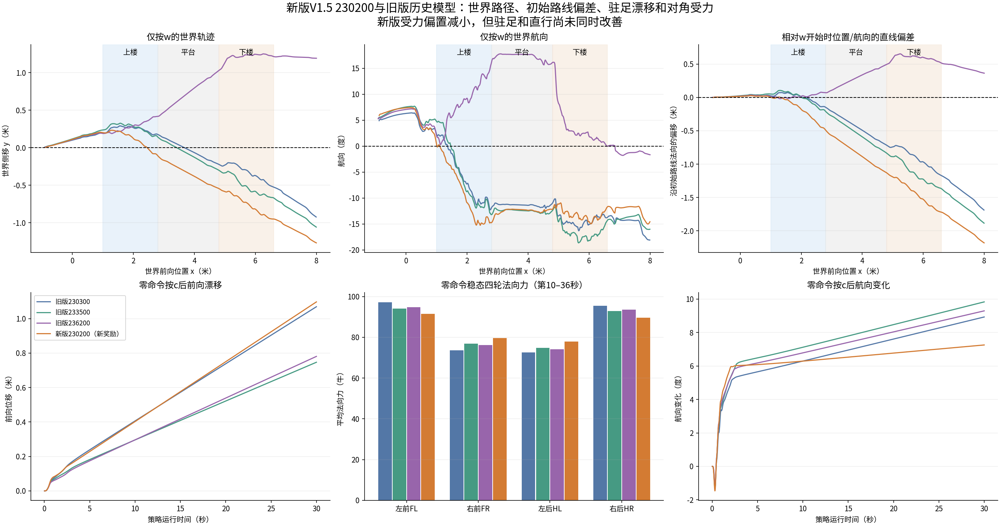
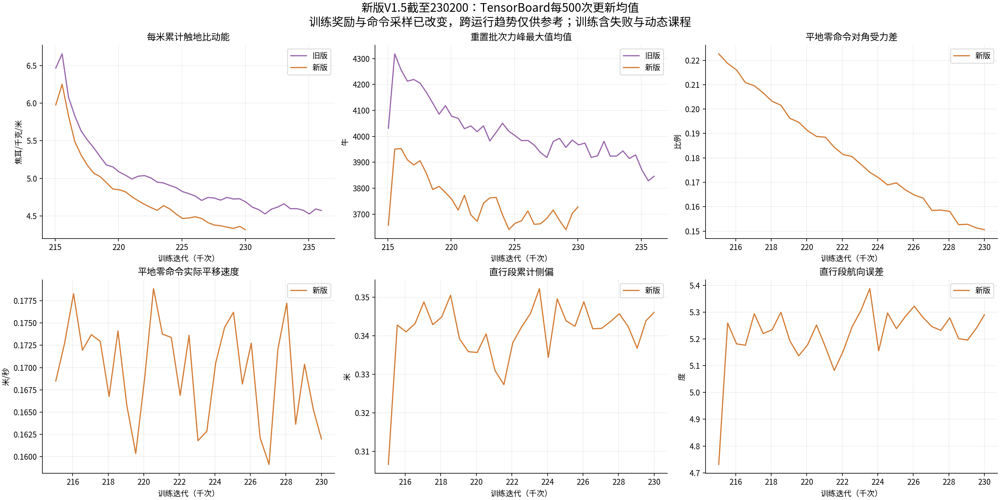

# 新版V1.5最新230200与旧版历史迭代模型效果分析

## 当前最新模型的身份

本轮固定分析10月12日00:52:08新启动训练的model_230200.pt，含驻足运动/姿态/载荷和世界直线路径奖励，以及世界Z轴角速度跟踪。旧运行236200虽然编号更大，但属于修改前的奖励版本。两条运行都从baseline 214700恢复；新版230200新增15500次更新，旧230300新增15600次，训练预算最接近。评测过程中训练继续，本文不会追逐后续新增checkpoint。
新运行目录：`logs/rsl_rl/deeprobotics_m20_quiet_landing_v1_5/2026-10-12_00-52-08_quiet_landing_v1_5_from_baseline`。实际保存的env配置及TensorBoard的新QuietStand/QuietRoute标签均确认新奖励接线。

## 结论

- 新版230200没有同时解决驻足、直行和柔和下楼三个目标，不建议仅凭编号或训练总奖励将它判为优于旧版。
- 平地零命令下对角组平均力差改善，但前移没有改善：旧230300/233500/236200为1.069/0.747/0.781米，新版1.097米。新版最后10秒仍有约0.035米/秒平均平移，漂移并非仅发生在按c的切换瞬间。
- 世界楼梯轴侧偏：新版上楼最大0.233米，较旧233500的0.326米减小；但楼顶0.543米、下楼0.951米，较旧233500的0.299/0.669米增加。新版比旧236200的1.251米总体侧偏小，但没有超过旧230300和233500。
- 下楼每次触地合力峰均值降低，触地速度/动能和每米累计动能没有同步降低。不能据此认定下楼噪声已经变小。楼顶平台的速度、动能和力峰也有退步。
- 上楼每米累计比动能为14.700 J/kg/m，优于三个旧模型；单次力峰均值605N，仍高于旧230300/233500的579/565N。降低累计量和降低每次冲击是不同的结果。
- 新版训练中对角受力差下降、累计触地动能下降；驻足速度和世界路线误差尚无持续改善证据。当前更适合作为继续调试的候选，而非已验证的替代模型。

## 同条件MuJoCo实测

真实all_terrain地形、原interactive_rollout、固定PD和原244D Actor输入/16D动作；z站起，第6秒c，第8秒开始机身命令[0.7,0,0]，36秒结束。另各有全程零速度回放。窗口绘图、键盘事件源和墙钟等待被无界面替代，物理、策略、控制器与观测计算保持原实现；没有外部航向或侧偏反馈。
共8条有效确定性回放均无摔倒，4条移动回放均越过楼梯段机身x=6.6米；36秒内未完成38米全地形，因此本文只比较共同楼梯空间路段和零命令驻足，不报告全地形成功率。旧230300/233500回放按checkpoint/源码/条件哈希核验后复用；旧236200与新版230200在本轮实际回放。

|模型|零命令30秒前移_m|零命令航向变化_deg|稳态对角力差|楼梯最大世界侧偏_m|最大世界航向_deg|相对W开始路线侧偏_m|楼梯耗时_s|
|---|---:|---:|---:|---:|---:|---:|---:|
|旧版230300|1.069|8.93|13.71%|0.525|16.30|1.171|8.170|
|旧版233500|0.747|9.83|10.40%|0.669|18.63|1.367|8.670|
|旧版236200|0.781|9.30|11.22%|1.251|17.76|0.652|8.450|
|新版230200（新奖励）|1.097|7.26|6.95%|0.951|15.24|1.720|8.195|

对角力差定义为|FL+HR−FR−HL|/ΣF，F取第10–36秒各轮法向力时间平均，包含零力。这仅反映两组对角轮的偏载，不能单独证明四轮均载、俯仰或横滚已改善。
上表同时给世界楼梯轴和W开始位置/航向所定义直线的偏差，避免把最大世界航向略小误解为走得更直。各模型W开始前已偏航约4.9–5.9°；新版相对初始路线侧偏1.720米，也没有体现直行改善。初始路线侧偏与训练中的长期段参考线不完全同口径。

|模型|路段|事件数|法向速度均值_m/s|比动能均值_J/kg|轮体动能均值_J|40ms合力峰均值_N|P95_N|最大值_N|每米累计比动能_J/kg/m|
|---|---|---:|---:|---:|---:|---:|---:|---:|---:|
|旧版230300|楼梯总体|115|0.6695|0.5003|0.3192|383.2440|1185.8037|1976.3664|10.0240|
|旧版230300|上楼|32|1.0744|0.9629|0.6144|579.2860|1299.1579|1976.3664|16.7934|
|旧版230300|楼顶平台|12|0.1853|0.1038|0.0663|220.6615|747.3115|1293.2607|0.6115|
|旧版230300|下楼|71|0.5689|0.3587|0.2289|322.3658|1062.3720|1708.5913|13.6981|
|旧版233500|楼梯总体|118|0.6569|0.4543|0.2898|357.8944|1072.3106|1502.7352|9.2603|
|旧版233500|上楼|30|1.1650|1.0211|0.6515|565.0399|1094.9881|1502.7352|16.5788|
|旧版233500|楼顶平台|15|0.2808|0.1710|0.1091|227.5002|933.2449|1156.3176|1.2529|
|旧版233500|下楼|73|0.5253|0.2795|0.1783|299.5595|912.4498|1346.4619|10.8157|
|旧版236200|楼梯总体|84|0.8888|0.6288|0.4012|485.9390|1185.2910|1532.4888|9.1256|
|旧版236200|上楼|31|1.2298|1.0208|0.6513|621.4929|1237.1591|1532.4888|17.2862|
|旧版236200|楼顶平台|6|0.3847|0.1464|0.0934|230.8587|470.0555|513.5522|0.4208|
|旧版236200|下楼|47|0.7282|0.4318|0.2755|429.0945|1170.5147|1354.2598|10.8976|
|新版230200（新奖励）|楼梯总体|114|0.7118|0.5178|0.3304|371.9405|1091.5578|1444.5967|10.2129|
|新版230200（新奖励）|上楼|29|1.1082|0.9415|0.6007|605.3797|1333.9830|1444.5967|14.7004|
|新版230200（新奖励）|楼顶平台|9|0.5509|0.3655|0.2332|339.8054|1181.1627|1334.1366|1.6063|
|新版230200（新奖励）|下楼|76|0.5796|0.3742|0.2388|286.6704|945.0777|1108.2710|15.2258|

### 新版相对旧233500

|路段|触地速度均值|比动能均值|力峰均值|每米累计比动能|事件数|
|---|---:|---:|---:|---:|---:|
|楼梯总体|+8.4%|+14.0%|+3.9%|+10.3%|-3.4%|
|上楼|-4.9%|-7.8%|+7.1%|-11.3%|-3.3%|
|楼顶平台|+96.2%|+113.8%|+49.4%|+28.2%|-40.0%|
|下楼|+10.3%|+33.9%|-4.3%|+40.8%|+4.1%|

下楼新版76次触地，旧230300/233500/236200分别71/73/47次。新版相对旧233500：速度+10.3%，比动能+33.9%，力峰均值−4.3%，每米累计比动能+40.8%。相对旧230300这个更接近训练预算的参考：速度+1.9%，比动能+4.3%，力峰均值−11.1%，每米累计比动能+11.2%。力峰P95相对旧233500也增加约3.6%，均值降低没有保证尾部冲击降低。

## TensorBoard：趋势与运行间比较

新日志冻结前缀截至迭代230208，共129个标量标签。新checkpoint窗口[229200,230200)，早期窗口[214800,215800)，各1000次更新。旧窗口也取各checkpoint前1000次更新。训练包含失败、动态地形课程及不同命令采样，跨运行数值不可视为固定测试集。

|指标|旧230300|旧233500|旧236200|新版230200|新版早期215800|新版早期→当前|
|---|---:|---:|---:|---:|---:|---:|
|QuietLanding/all/pre_speed_mean_m_s|0.402002|0.401666|0.3997|0.410023|0.447402|-8.35%|
|QuietLanding/all/specific_energy_mean_J_kg|0.269418|0.268544|0.265427|0.27711|0.339695|-18.42%|
|QuietLanding/specific_energy_per_m_J_kg_m|4.70575|4.63358|4.57358|4.34189|6.11575|-29.00%|
|QuietLanding/impact_window_force_max_N|3976.55|3924.9|3838.97|3703.94|3804.23|-2.64%|
|QuietLanding/impact_window_excess_impulse_max_N_s|45.0179|43.9962|41.5523|38.5035|35.5012|+8.46%|
|QuietLanding/events_per_m|18.5749|18.3248|18.2009|16.7189|19.4636|-14.10%|
|Metrics/base_velocity/error_vel_xy|0.440513|0.438399|0.438886|0.380738|0.353966|+7.56%|
|Metrics/base_velocity/error_vel_yaw|0.295242|0.296298|0.292543|0.273014|0.279322|-2.26%|
|Train/mean_episode_length|997.259|996.847|996.934|997.467|998.436|-0.10%|
|Task/episode_reward_rate|4.49735|4.50998|4.55989|4.81791|4.42975|+8.76%|
|Loss/value|0.698906|0.699351|0.678641|0.544957|0.65451|-16.74%|
|Loss/anchor|0.0635113|0.066267|0.066586|0.0683003|0.0257415|+165.33%|
|Policy/mean_std|0.175101|0.16727|0.161523|0.156684|0.225989|-30.67%|
|QuietLoad/stable_support_fraction|0.000518628|0.000769391|0.00102313|0.00376564|8.95156e-05|+4106.69%|
|QuietLoad/stable_diagonal_abs_mean|0.167774|0.166615|0.168989|0.143107|0.18101|-20.94%|
|QuietReward/quiet_load_balance|-1.46657e-05|-2.02024e-05|-2.68437e-05|-7.61339e-05|-3.27554e-06|+2224.32%|
|QuietReward/quiet_impact_peak|-0.321402|-0.317826|-0.312368|-0.273158|-0.348666|-21.66%|
|QuietStand/mean_xy_speed_m_s|—|—|—|0.165385|0.170629|-3.07%|
|QuietStand/diagonal_abs_mean|—|—|—|0.151109|0.220684|-31.53%|
|QuietStand/idle_flat_fraction|—|—|—|0.0669943|0.0657411|+1.91%|
|QuietStand/loaded_fraction|—|—|—|0.908321|0.882107|+2.97%|
|QuietRoute/cross_track_abs_mean_m|—|—|—|0.344167|0.324676|+6.00%|
|QuietRoute/heading_error_abs_mean_deg|—|—|—|5.25308|4.99527|+5.16%|
|QuietRoute/straight_fraction|—|—|—|0.336106|0.360572|-6.79%|

- 新版早期→当前：触地速度0.447→0.410m/s（−8.4%），触地比动能0.340→0.277J/kg（−18.4%），每米累计比动能6.116→4.342（−29.0%）。训练有学习效果，但不能替代本次原部署下楼结果。
- 平地零命令门控内对角差0.221→0.151（−31.5%），平移速度0.171→0.165m/s（仅−3.1%）。零命令平地覆盖率约6.7%，该门控内四轮加载覆盖率约90.8%；不能用旧稳定支撑门控的低覆盖率代替新增驻足奖励的覆盖率。
- 路线侧偏0.325→0.344m（+6.0%），航向误差5.00→5.25°（+5.2%）。直行门控覆盖率约33.6%。在训练地形/命令分布变化下，这不能独立证明奖励无效，但也没有改善证据。
- 最新1000次更新里，QuietReward/quiet_idle_motion、quiet_idle_pose、quiet_idle_load、quiet_straight_route均值分别−0.04850、−0.07101、−0.05181、−0.33875，均非零。新增奖励确实在训练中被计算，驻足/路线效果不足不能归因于仍在跑旧代码。
- 新版重置批次超额冲量最大值均值35.50→38.50N·s（+8.5%），未随触地速度一同降低；速度跟踪误差0.354→0.381（+7.6%）。任务性能和冲击尾部仍需一起观察。
- 新版每米累计比动能4.342低于旧230300/233500/236200训练窗口，但触地速度和单次比动能略高；不同命令采样、触地事件数与课程会改变均值，不能用累计量单独宣告全面优于旧版。

## 下一步判断

保留新版230200作为新奖励阶段的参考，旧233500作为原部署下楼单次冲击/驻足参考，旧230300作为近似相同训练预算参考。当前新版尚未形成一致改进，不应删除旧候选或直接将它作为默认部署。建议后续首先验证零命令实际速度为何几乎不降，以及平地门控、奖励归一化和命令采样是否足以压制持续轮滚；直行需要按上楼/平台/下楼拆分训练诊断，避免总航向误差掩盖平台和下楼的累计侧偏。
奖励已开始改善受力偏置和训练累计触地能量，可以继续做有界训练与同条件检查，但不能预期仅增加迭代就必然解决驻足和下楼。若多个后续检查点仍重复上述退步，再调整奖励，而不是扩大步态修改范围。本文只分析，未改配置或中断训练。

## 测量定义与限制

- 速度取轮心在接触求解前沿地图估计表面法向的接近速度；比动能e=v²/2，轮体法向动能代理E=0.638e焦耳（轮体质量来自MuJoCo）。不是整机有效碰撞能量，也不是实测声音/分贝。速度含躯干与腿运动，不等于轮胎表面旋转速度。
- 合力来自MuJoCo真实地形接触力向量；每次有效新触地取接下来8个5ms物理步的合力模长最大值。不是把整段平均支撑力称为冲击力。接触末尾不足40ms的事件不纳入。力峰和能量已从原始数组独立重算通过。
- quiet.npz元数据中的energy_definition沿用了旧post_step_center_speed_squared描述；本次实际数组specific_energy已核验等于speed²/2，报告采用采样器真实计算的触地前法向速度定义，不按旧描述解释。
- 动态触地从W开始后计算，排除站起和切策略瞬态；若回放跌倒，整条不纳入触地/驻足统计。本轮有效8条均无跌倒，不存在跌倒尖峰污染平均。
- 上楼/平台/下楼按机身世界x范围1–2.8、2.8–4.8、4.8–6.6米归类，前后轮可能跨段。每米累计量分母是该空间范围内的XY实际行程；侧偏会使分母变大，不是楼梯设计长度。比较时同时呈现路径、耗时及事件数。
- TensorBoard统计按日志记录等权平均，不是全触地事件加权；力峰/超额冲量指标是重置批次最大值的均值，不能与MuJoCo单次触地力峰均值直接横比。
- 每个模型/条件一条确定性轨迹，没有不同种子、速度、载荷或扰动统计。全部无摔倒只能说明本次8条回放，不能当作泛化成功率。
- 以前带外部路线纠偏、0.5米/秒的38米全地形结果不与本次仅W=0.7米/秒的原部署数据混用。
