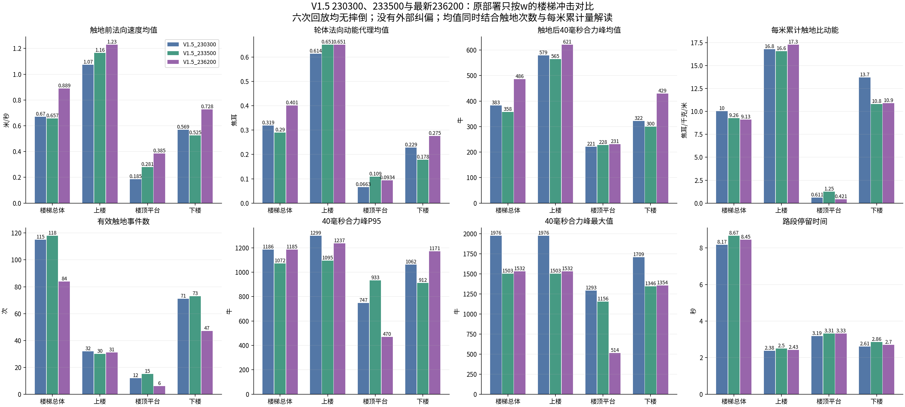
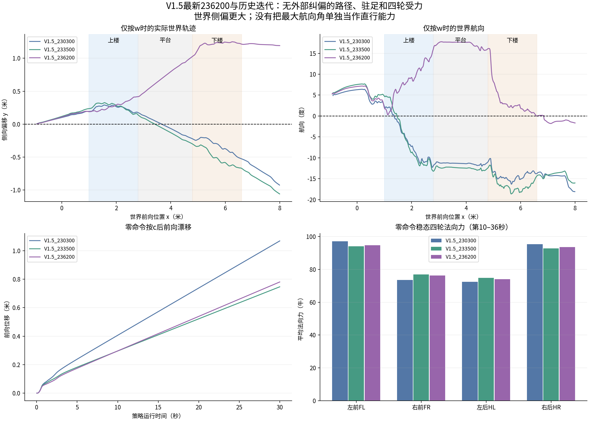
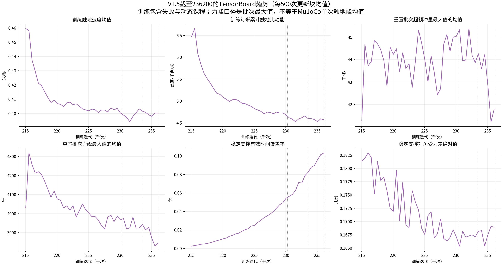

# V1.5最新236200与230300、233500实际部署对比

本次最新保存checkpoint固定为236200，来自修改前的V1.5训练运行，不含新驻足及世界路线奖励。
三个checkpoint均使用原interactive_rollout操作：z站起，第6秒c，第8秒开始w=机身[0.7,0,0]，至第36秒。另各有一条全程零速度命令回放。关闭窗口绘图和墙钟等待，使用真实MuJoCo物理、原PD、原Actor输入；没有外部路线反馈。
两条最新回放本轮真实执行，四条历史回放在源码、checkpoint哈希及操作条件核验后复用。六条回放均无摔倒；三个移动回放都越过楼梯段终点，但36秒内未完成38米全地形。

## 结论

- 最新没有表现出一致优于历史模型的效果。相对233500，楼梯触地均值更硬，世界直行更差；同时触地次数减少，每米累计触地能量略降，不能用某一项单独概括整体噪声。
- 下楼触地速度均值变化+38.6%，比动能均值+54.5%，40ms合力峰均值+43.2%；每米累计比动能仅变化+0.8%。
- 楼梯总体触地次数118→84，每米累计比动能9.260→9.126 J/kg/m。均值变大部分受到低强度小触地减少影响，不应忽略事件数。
- 最大世界侧偏0.669→1.251米，直行偏差明显变大。偏移方向改变，比较使用绝对值；航向最大值略低也不能抵消累计路径偏移。
- 零命令漂移和对角偏载依旧存在。相对230300有改善，但相对233500未继续改善。
- TensorBoard显示训练冲击代理量缓慢改善，不能直接证明这次0.7m/s原部署上下楼也改善。没有新奖励的运行不应期待自行解决刚定位的驻足和直行问题。
- 对本次原部署直行与下楼单次冲击目标，233500比236200更值得保留作参考。230300仍是先前“带路线反馈、较低速度、完整全地形”评测的累计能量候选；本次条件不同，不能据此直接改写那个结果。

## 零命令与直行

|模型|零命令30秒前向位移_m|航向变化_deg|稳态对角组力差占总力|楼梯最大侧偏_m|楼梯最大航向绝对值_deg|楼梯耗时_s|
|---|---:|---:|---:|---:|---:|---:|
|V1.5_230300|1.069|8.93|13.71%|0.525|16.30|8.170|
|V1.5_233500|0.747|9.83|10.40%|0.669|18.63|8.670|
|V1.5_236200|0.781|9.30|11.22%|1.251|17.76|8.450|

## 触地指标

|模型|路段|事件数|法向速度均值_m/s|比动能均值_J/kg|轮体法向动能均值_J|40ms合力峰均值_N|P95_N|最大值_N|每米累计比动能_J/kg/m|
|---|---|---:|---:|---:|---:|---:|---:|---:|---:|
|V1.5_230300|楼梯总体|115|0.6695|0.5003|0.3192|383.2440|1185.8037|1976.3664|10.0240|
|V1.5_230300|上楼|32|1.0744|0.9629|0.6144|579.2860|1299.1579|1976.3664|16.7934|
|V1.5_230300|楼顶平台|12|0.1853|0.1038|0.0663|220.6615|747.3115|1293.2607|0.6115|
|V1.5_230300|下楼|71|0.5689|0.3587|0.2289|322.3658|1062.3720|1708.5913|13.6981|
|V1.5_233500|楼梯总体|118|0.6569|0.4543|0.2898|357.8944|1072.3106|1502.7352|9.2603|
|V1.5_233500|上楼|30|1.1650|1.0211|0.6515|565.0399|1094.9881|1502.7352|16.5788|
|V1.5_233500|楼顶平台|15|0.2808|0.1710|0.1091|227.5002|933.2449|1156.3176|1.2529|
|V1.5_233500|下楼|73|0.5253|0.2795|0.1783|299.5595|912.4498|1346.4619|10.8157|
|V1.5_236200|楼梯总体|84|0.8888|0.6288|0.4012|485.9390|1185.2910|1532.4888|9.1256|
|V1.5_236200|上楼|31|1.2298|1.0208|0.6513|621.4929|1237.1591|1532.4888|17.2862|
|V1.5_236200|楼顶平台|6|0.3847|0.1464|0.0934|230.8587|470.0555|513.5522|0.4208|
|V1.5_236200|下楼|47|0.7282|0.4318|0.2755|429.0945|1170.5147|1354.2598|10.8976|

## TensorBoard等长窗口

日志共117个标量指标，冻结至236249；比较每个checkpoint前1000次更新[k−1000,k)，晚于236200的日志不用于它的窗口统计。训练包含失败与动态课程，未分上/下楼。

|指标|230300前1000更新|233500前1000更新|236200前1000更新|最新相对233500|
|---|---:|---:|---:|---:|
|QuietLanding/all/pre_speed_mean_m_s|0.402002|0.401666|0.3997|-0.49%|
|QuietLanding/all/specific_energy_mean_J_kg|0.269418|0.268544|0.265427|-1.16%|
|QuietLanding/specific_energy_per_m_J_kg_m|4.70575|4.63358|4.57358|-1.29%|
|QuietLanding/impact_window_force_max_N|3976.55|3924.9|3838.97|-2.19%|
|QuietLanding/impact_window_excess_impulse_max_N_s|45.0179|43.9962|41.5523|-5.55%|
|QuietLanding/events_per_m|18.5749|18.3248|18.2009|-0.68%|
|Metrics/base_velocity/error_vel_xy|0.440513|0.438399|0.438886|+0.11%|
|Metrics/base_velocity/error_vel_yaw|0.295242|0.296298|0.292543|-1.27%|
|Train/mean_episode_length|997.259|996.847|996.934|+0.01%|
|Task/episode_reward_rate|4.49735|4.50998|4.55989|+1.11%|
|Loss/value|0.698906|0.699351|0.678641|-2.96%|
|Loss/anchor|0.0635113|0.066267|0.066586|+0.48%|
|Policy/mean_std|0.175101|0.16727|0.161523|-3.44%|
|QuietLoad/stable_support_fraction|0.000518628|0.000769391|0.00102313|+32.98%|
|QuietLoad/stable_diagonal_abs_mean|0.167774|0.166615|0.168989|+1.42%|
|QuietReward/quiet_load_balance|-1.46657e-05|-2.02024e-05|-2.68437e-05|+32.87%|
|QuietReward/quiet_impact_peak|-0.321402|-0.317826|-0.312368|-1.72%|

最新窗口稳定支撑有效时间覆盖率为0.1023%；该门控内对角偏差为0.169。均衡惩罚的日志绝对值仅约为冲击峰惩罚的0.0086%，覆盖和贡献仍很低。

## 测量与限制

- 动态触地汇总从w开始后计算，排除站起和c切换瞬态；若回放摔倒，整条回放不纳入冲击及驻足平均。本轮无需排除，全部无摔倒。
- 速度取真实碰撞求解前轮心沿地图估计法向的接近速度，specific_energy=speed²/2。轮体质量来自物理模型，乘比动能得到轮体法向动能代理，不是整机有效碰撞能量。
- 接触力为静态地形实际合力模长，取触地起8个5ms物理步的峰值；末尾不足完整40ms窗口的事件排除。法向力用于受力平均，合力峰用于冲击，二者不是同一个量。
- 路段由机身x切分，前后轮可能跨段。只在同一楼梯空间范围比较累计量，没有把三条不同长度的整段回放称为全地形比较。
- 零命令受力取第10–36秒时间平均，包含零力；对角比值由各轮时间平均力计算，不等于训练稳定门控内的对角差。MuJoCo采样器默认门控不作为训练V1.5门控验收。
- TensorBoard为每次日志记录值的等权均值，不是汇总所有触地后按事件数加权的物理均值。批次最大力峰均值与单次MuJoCo触地力峰均值不能直接横比。
- 每个条件只一条确定性回放；没有多速度、多种初始化或扰动成功率统计，未量真实声音/分贝。后续不应把这次单回合变化当作确定的长期噪声改善或退化。
- 本轮只分析，不修改奖励、模型、部署接口、训练配置或运行中的训练进程。
