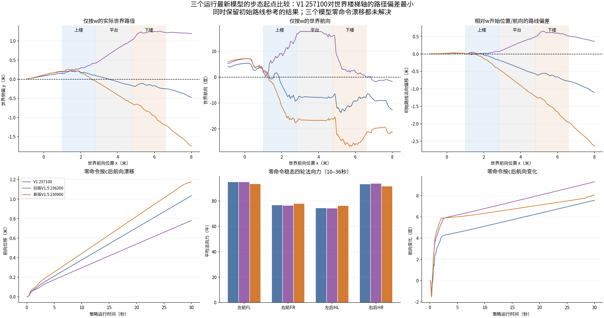
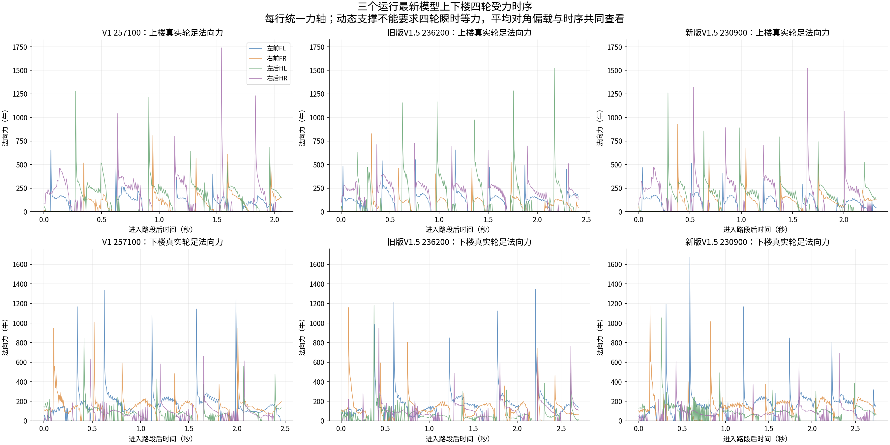
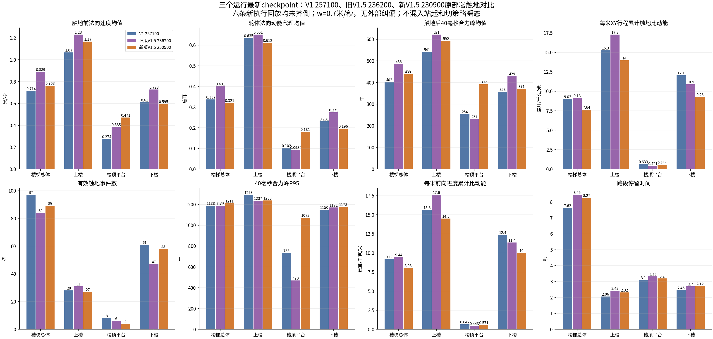

# V1与V1.5两个运行的最新checkpoint：步态调整起点选择

## 建议

**这三个最新checkpoint中，建议选择V1 model_257100.pt作为步态调整起点。** 它在本次仅w、无外部纠偏的原部署上下楼中，世界楼梯轴侧偏、世界航向和楼梯动态平均对角偏载较小，同时保留了比较好的触地冲击水平。旧V1.5 236200的驻足漂移较小，但路线偏差和单次冲击较大；新V1.5 230900累计触地动能最低、静态偏载较小，但路线偏航与驻足漂移仍然较大。
上一轮推荐旧233500是在历史模型集合中选择。本轮按用户要求，只比较三个运行各自最新模型，233500没有参加本轮新回放；不能把本次推荐解释为证明257100优于233500所有方面。

推荐checkpoint：

```text
logs/rsl_rl/deeprobotics_m20_quiet_landing_v1/2026-10-10_00-48-58_quiet_landing_v1/model_257100.pt
```

若后续从V1恢复进入步态实验，保留当前满意的quiet_landing奖励约束，逐项加入/调整驻足和直行奖励；保持244D Actor观测、16D动作及固定PD。模型起点和继续训练时的奖励配置是两个选择，选V1模型不意味着回退柔和落地目标。此次只评测，未启动或改动训练。

## 固定比较对象和操作条件

冻结时刻：2026-10-12T11:54:12.232532+08:00。训练继续产生的后续checkpoint不追入这次比较。

|模型|运行开始时间|checkpoint|从baseline 214700新增更新|
|---|---|---:|---:|
|V1 257100|2026-10-10_00-48-58|257100|42400|
|旧版V1.5 236200|2026-10-10_17-55-27|236200|21500|
|新版V1.5 230900|2026-10-12_00-52-08|230900|16200|

新版230900属于包含驻足与世界直线奖励的10月12日运行；旧236200属于修改前的10月10日运行。三者训练时长不相等，本轮用于选择已有模型起点，不用于断言哪套奖励算法更优。
每个模型全新执行两条真实MuJoCo物理回放：all_terrain、z站起、第6秒c；移动条件第8秒开始仅w（机身[0.7,0,0]），驻足条件全程零命令，均到第36秒。使用生产interactive_rollout，只替换窗口绘图、键盘事件源和墙钟等待，不加外部路径/航向反馈。
六条回放均未跌倒，三个移动回放均越过机身x=6.6米楼梯段。未完成38米all_terrain，因此比较共同楼梯空间段和驻足，不报告完整全地形成功率。

## 驻足与直行

|模型|零命令30秒前移_m|最后10秒平移速度_m/s|稳态对角组力差|楼梯最大世界侧偏_m|楼梯最大世界航向_deg|楼梯耗时_s|
|---|---:|---:|---:|---:|---:|---:|
|V1 257100|1.035|0.0331|10.97%|0.248|13.82|7.625|
|旧版V1.5 236200|0.781|0.0245|11.22%|1.251|17.76|8.450|
|新版V1.5 230900|1.176|0.0357|9.14%|1.200|26.71|8.265|

- V1最大世界侧偏0.248米，旧/新版V1.5为1.251/1.200米；V1最大世界航向13.82°，旧/新版为17.76°/26.71°。对于直线进入楼梯并沿世界楼梯轴登顶的目标，V1明显更接近。V1也还存在偏航，并未达到直行问题已经解决。
- 零命令漂移三者均未解决；旧V1.5最小，新版V1.5最大。全部四轮在稳态都保持加载，漂移不是某轮长期悬空导致的简单现象。
- 对角力差|FL+HR−FR−HL|/ΣF使用第10–36秒各轮法向力平均（含零力）。新版9.14%优于V1的10.97%和旧V1.5的11.22%，但受力偏置改善没有保证驻足变好。不能由对角力差单独推出漂移的原因。



### 区分世界楼梯轴与W开始时的路线

|模型|W开始世界航向_deg|相对W开始位置/航向最大侧偏_m|相对W开始航向最大角度变化_deg|楼梯时间平均对角组力差|
|---|---:|---:|---:|---:|
|V1 257100|4.00|0.777|17.81|1.17%|
|旧版V1.5 236200|5.28|0.652|12.48|14.35%|
|新版V1.5 230900|5.82|1.955|32.53|2.21%|

旧V1.5相对W开始航向定义的参考线偏差略小于V1，不能说V1在每个直线指标上都最好。但用户要求沿楼梯轴直线进入/登顶时，旧版的世界侧偏和起点/终点路线更不合适，故仍以V1作为调整起点。未来评测也应保留两种参考线口径，不按其中较好的一项选择性报告。
楼梯动态平均对角组力差：V1约1.17%，新版V1.5约2.21%，旧版约14.35%。这是整段时间平均，不能解释为每一瞬间四轮等力，也不能要求摆动轮与支撑轮等力。

|模型|稳态平均横滚_deg|稳态平均俯仰_deg|稳态最大横滚绝对值_deg|稳态最大俯仰绝对值_deg|
|---|---:|---:|---:|---:|
|V1 257100|-0.0391|-0.1364|0.0394|0.1378|
|旧版V1.5 236200|-0.0714|-0.0870|0.0719|0.0898|
|新版V1.5 230900|-0.0775|-0.1534|0.1022|0.1621|

本次稳态横滚/俯仰量都很小，不能把持续前移和偏航描述成大幅身体倾倒。按c后的瞬态可从完整姿态原始数组复查；上述稳态统计从第10秒起。



## 柔和落地是否保留

|模型|路段|事件数|法向速度均值_m/s|比动能均值_J/kg|轮体法向动能均值_J|40ms合力峰均值_N|P95_N|每米XY比动能_J/kg/m|每米前向比动能_J/kg/m|
|---|---|---:|---:|---:|---:|---:|---:|---:|---:|
|V1 257100|楼梯总体|97|0.7138|0.5281|0.3369|402.1073|1188.1596|9.0199|9.1708|
|V1 257100|上楼|28|1.0666|0.9952|0.6349|541.2971|1292.9812|15.2666|15.6149|
|V1 257100|楼顶平台|8|0.2743|0.1594|0.1017|253.7094|733.4127|0.6333|0.6418|
|V1 257100|下楼|61|0.6095|0.3621|0.2310|357.6790|1150.0203|12.0557|12.3856|
|旧版V1.5 236200|楼梯总体|84|0.8888|0.6288|0.4012|485.9390|1185.2910|9.1256|9.4449|
|旧版V1.5 236200|上楼|31|1.2298|1.0208|0.6513|621.4929|1237.1591|17.2862|17.6079|
|旧版V1.5 236200|楼顶平台|6|0.3847|0.1464|0.0934|230.8587|470.0555|0.4208|0.4432|
|旧版V1.5 236200|下楼|47|0.7282|0.4318|0.2755|429.0945|1170.5147|10.8976|11.3660|
|新版V1.5 230900|楼梯总体|89|0.7629|0.5034|0.3212|438.8087|1210.9496|7.6424|8.0320|
|新版V1.5 230900|上楼|27|1.1670|0.9586|0.6116|591.9990|1238.0405|13.9659|14.5031|
|新版V1.5 230900|楼顶平台|4|0.4707|0.2832|0.1807|391.8033|1072.6189|0.5441|0.5706|
|新版V1.5 230900|下楼|58|0.5949|0.3067|0.1957|370.7378|1177.5813|9.2647|9.9956|

- V1上楼速度、单次力峰均值均低于两个V1.5最新模型。上楼比动能均值略高于新版V1.5，新版累计量也更低；V1并非每项冲击指标最优。
- V1下楼速度0.610m/s、比动能0.362J/kg、合力峰358N；新版分别0.595、0.307、371，旧版0.728、0.432、429。V1下楼力峰均值/P95较低，新版下楼能量较低。
- 楼梯总体每米XY累计比动能V1为9.020，旧版9.126，新版7.642J/kg/m。新版比V1低15.3%；改用前向进度分母后，新版8.032仍低于V1的9.171，说明其累计能量优势并非完全由绕行使分母变大造成。
- 新版平台仅4次有效触地，单次平均速度、动能和力峰都高于V1，但累计量略低；少量事件的P95/均值不应过度解读。完整逐次CSV与事件数一并保留。



## 起点选择的取舍

用户已经满意当前柔和落地，下一阶段的主要问题是零命令驻足、直线进入/上下楼和支撑协调。在保留合理触地冲击的前提下，V1 257100的世界路线与动态对角负载更接近目标，因此本次三个最新模型中优先选它。新版V1.5 230900可保留作累计动能和静态受力平衡对照；旧236200可保留作零命令漂移较小的对照。
这不是新增控制策略、不是删除V1.5已有奖励、也不是宣告V1整体优于V1.5。一次固定速度回放无法覆盖速度、地形初始化、扰动和不同PD下的表现，推荐是现有证据支持的训练起点。

## 测量与核验

- 接触速度为碰撞求解前轮心沿地图估计表面法向的接近速度；比动能v²/2，轮体动能代理为轮体质量0.638kg乘比动能，不是整机有效碰撞能量或真实声音/分贝。
- 接触力为真实静态地形接触合力向量；新触地起8个5ms物理步取合力模长峰值。末尾不足完整40ms的事件不纳入。力峰与法向平均支撑力不是同一量。
- quiet.npz旧元数据energy_definition提到post_step平动速度；报告采用采样器实际的speed²/2法向触地前速度数组，已独立重算核验。
- 只统计W开始后动态触地，排除站起及c切换瞬态。若跌倒，整条排除，失败单列；本次六条全部未摔倒，不存在跌倒瞬间的大力污染。
- 路段按机身x划分，前后轮可能跨段。XY行程分母保留，同时新增前向进度分母，避免侧向绕行稀释每米累计指标。
- 最新checkpoint/源码/物理模型/地形哈希、操作条件、保存的实际命令值、比动能与40ms力峰均值均核验通过。每条回放资源峰值实测见资源日志，原部署源码和训练保持不变。
- 仅一个速度、每条件一条确定性轨迹；没有完整38米全地形成功率或真机声音测试，不据此作泛化或实机结论。

|回放|峰值RSS_MiB|摔倒|
|---|---:|---|
|V1_257100 零命令|1077.2|否|
|V1_257100 仅w|1078.7|否|
|旧V1.5_236200 零命令|1076.6|否|
|旧V1.5_236200 仅w|1080.4|否|
|新V1.5_230900 零命令|1078.7|否|
|新V1.5_230900 仅w|1080.0|否|
