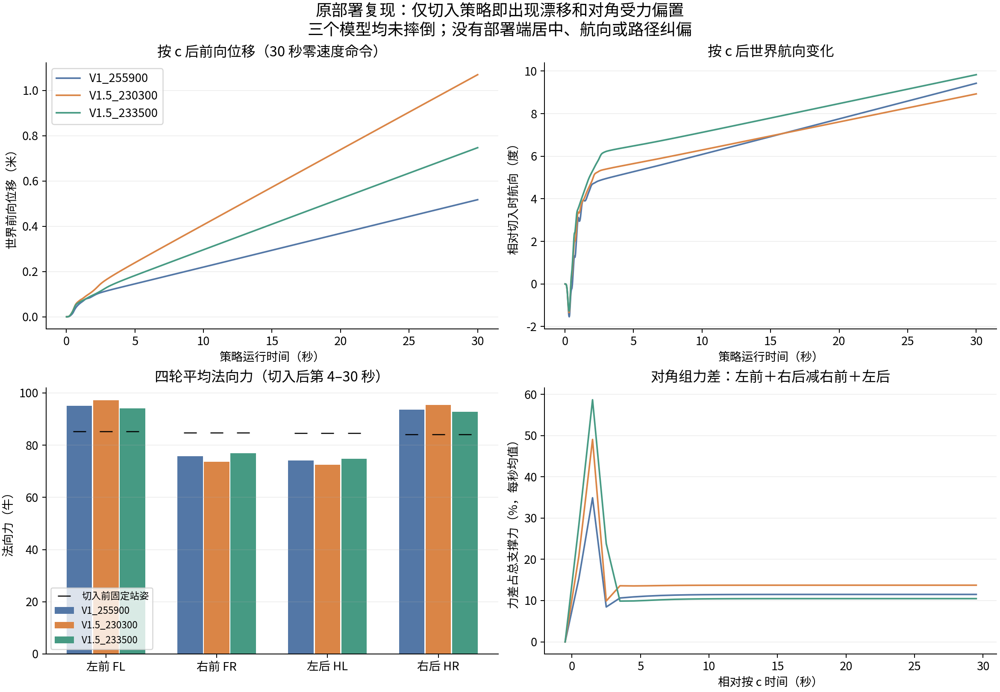
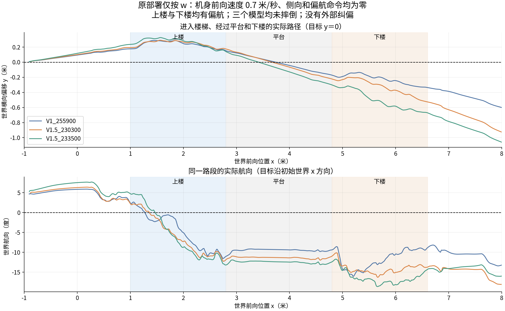

# 零命令对角偏载与仅 w 楼梯偏航

原部署复现了两个问题；V1.5 的训练奖励和诊断接线已修改并通过检查。**尚未使用新奖励训练模型，旧 checkpoint 的行为没有因此改变，不能宣称已经解决漂移或偏航。**

2026-10-12 用户明确范围：教师模型仅通过奖励续训，使只按 w 在上下楼和其他地形尽可能直行；允许 checkpoint resume，保持输入输出，不增加部署端路线反馈。这里的目标是减少策略自身产生的漂移和偏航，不以严格恢复任意扰动后的原始路线为本轮完成要求。

## 原部署复现

调用 `deploy_mujoco.interactive_rollout` 和原模型、原 PD、原 Actor 输入。仅用脚本代替窗口及按键事件，关闭绘图和实时等待；不改物理步进、动作或观测。地形为 `all_terrain`。来源、模型与操作条件见各模型的 `操作条件.json`；原部署源码及训练源码的修改前副本保存在 `修改前源码/`。

先按 z 完成站起，仿真第 6 秒按 c 切入策略。零命令试验一直不按速度键，持续到第 36 秒；仅 w 试验在第 8 秒开始保持 `[0.7,0,0]`，持续到第 36 秒。三个模型各进行这两次回放，均没有摔倒。这里没有开启 `--track-course`，也没有侧向、航向或路径反馈。此前采用居中纠偏的全地形通过结果不能证明原始策略只按 w 就能直行。

| 模型 | 零命令 30 秒前向位移 | 零命令航向变化 | 稳态对角组力差占总力 | 楼梯段最大世界侧偏 | 楼梯段最大航向绝对值 |
| --- | ---: | ---: | ---: | ---: | ---: |
| V1 255900 | 0.517 m | 9.43° | 11.43% | 0.335 m | 16.05° |
| V1.5 230300 | 1.069 m | 8.93° | 13.71% | 0.525 m | 16.30° |
| V1.5 233500 | 0.747 m | 9.83° | 10.40% | 0.669 m | 18.63° |

稳态受力取仿真第 10–36 秒，轮序 FL/FR/HL/HR。力差为 `(FL+HR−FR−HL)/总力`，表中是四轮时间平均力代入得到的比值。楼梯段按 root x∈[1,6.6] 统计，侧偏相对初始世界直线 y＝0。每种条件仅一个确定性回放，不能视作多次扰动成功率。





切入前的固定站姿四轮法向力约为 `[85.29,84.83,84.56,84.06] N`，对角组力差接近零。切入后 V1.5 233500 的平均力变为 `[94.14,76.89,74.84,92.82] N`，并伴随非零轮速和不对称腿部残差。这个对照定位到了策略切入后的变化；**它没有证明对角竖直力差是前移或偏航的唯一原因**。纯对角竖直力差本身不直接产生世界竖直轴的偏航力矩，轮子驱动力与水平接触力仍可能参与。

这些回放中零命令后段的平均横滚、俯仰幅度小于一度，最明显的是前移和航向改变。不能把视觉上的倾斜都解释成较大的机身横滚或俯仰。

## 原奖励为什么不足

原 `track_ang_vel_z_exp` 跟踪机身角速度的 z 分量：`exp(−(ω_b,z−c_z)²/σ²)`。倾斜时 `ω_b,z` 与世界竖直轴分量 `ω_w,z=e_zᵀ R(q)ω_b` 不同。现有 `stair_ascent_direction_cost` 虽然使用世界路径信息，却依赖上楼激活状态，不能给下楼提供相同约束。

无论选哪一个角速度坐标系，令角速度接近零都不会自动消除已积累的航向误差。例如转偏之后保持零角速度，机身仍会沿偏斜方向继续前进。世界竖直轴角速度在倾斜时也不严格等于欧拉航向角的导数，绝对航向误差需要另外计算。

原 V1.5 的动态稳定支撑平衡门控还要求四轮支撑、没有新触地、低垂直速度、低角速度及持续稳定，覆盖率很低。先前 TensorBoard 分析记录的后段覆盖率约 0.086%；不能仅提高这个门控下的权重就认为零命令站姿得到了足够训练。

## 训练侧修正

只在 V1.5 配置启用以下修正，保留原降落速度、冲击、加载率和平滑项。参数以配置类、`idle_stance_cost` 默认参数和已有 `traversal.TUNING` 为准，本说明不作为调参台账。

1. 原角速度跟踪项切换到已存在的 `track_ang_vel_z_world_exp`。
2. 原上楼路径项权重归零，改用 `quiet_straight_route`。在平地、上楼、平台、下楼都适用，累计世界侧向位移、世界侧向速度和相对参考航向误差；当前实际航向不会在每步覆盖参考航向。主动转弯、停止、改变平移方向或 episode 重置会重新建立参考。
3. 新增平地零命令 `quiet_idle_motion`：惩罚世界水平速度和世界竖直轴角速度。
4. 新增平地零命令 `quiet_idle_pose`：约束腿部默认站姿偏差和轮关节速度。
5. 新增平地零命令 `quiet_idle_load`：惩罚持续对角组受力偏差和缺失轮支撑。其激活不依赖已经达到的低速度、低倾斜，移动或卸载一轮都不能让驻足目标整体消失。四轮有效支撑掩码只用于诊断选样。
6. 提高零命令、纯前后向命令的采样比例，沿用原命令生成器，不增加命令类。保留侧移、转弯和组合命令。

记 `S(u)=min(u²,4)`，驻足运动代价为 `S(‖v_w,xy‖/v_ref)+S(ω_w,z/ω_ref)`。姿态代价为腿关节偏差的 `S` 均值与轮关节速度的 `S` 均值之和。受力项先对 `|D|` 扣除死区，归一化后取 `S`，并为各轮低于支撑阈值的缺口加连续代价；总力不足时关闭不可靠的对角比值，缺支撑代价仍保留。高程图无效或地形非平时不强制默认驻足姿态，正常非零命令摆腿也不会被此项约束。

路径参考在一个直行段的起点建立。零偏航命令时，参考方向固定，侧向误差由每步实际世界位移在参考法向上的投影累积；航向误差按环绕角计算。代价沿用上楼方向项的死区、尺度及有界 pseudo-Huber 形式，避免同一上楼路径被两项重复收费。

Actor 仍为 57+187＝244D，Critic 285D，动作 16D，固定 PD。没有改部署接口，也没有为旧模型增加自动纠偏。新的 `QuietStand/*`、`QuietRoute/*` 和对应 `QuietReward/*` 只记录本次驻足和直行目标，没有带回旧的步态调试 cards。路径奖励设零做消融时，诊断仍正常计算。

## 已执行验证及边界

- `check_quiet_landing.py`、`check_quiet_extended.py`、`check_quiet_stability.py` 均通过。反例覆盖同一步不重复累积、整体旋转不变、下楼不关路径、主动转弯、重置、机身与世界角速度区别，以及移动、卸载轮子、无效地形等门控行为。
- 独立同 family Codex 只读复审通过。发现并修复了以“四轮都触地”关闭整个驻足受力项的逃逸；复算均衡支撑代价为零，单轮及全轮卸载均为正。没有进行跨 family 复审。
- 最终实际 Isaac 配置创建 16 环境，加载现有 V1.5 230300 Actor，运行 121 步并退出码 0。四个新代价都出现非零值，角速度函数绑定正确，旧上楼路径项关闭，驻足与路径日志齐全，关闭路径奖励后的诊断反例通过。完整结果见 `实际训练环境接线核验.json` 和 `实际训练环境接线核验_最终修正.log`。
- 前两次接线测试没有完成，第三次只证明当时版本。最终扩展检查发现统计调用返回类型错误，已修复并重新完整通过；旧失败日志保留，不能按部分非零奖励或退出码单独认定通过。
- **本轮没有正式 PPO 长训练，也没有新 checkpoint 的 MuJoCo 改善数据。** 现有训练进程不会热加载源码，需要重启为新的训练运行。

还有一个能力边界：当前 Actor 没有累计世界航向或路径误差输入，策略是前馈 MLP。因此新增奖励可以训练减少系统性偏航，但不能保证在任意已经偏离的平地状态自动找回初始直线。严格恢复世界直线需要策略可见的航向/路径反馈，例如部署命令反馈或观察接口调整；当前没有启用它们。

## 训练和后续验收

继续沿用原 `train.py`。下面从 baseline 完整 resume，以保留和早期 V1 对照一致的起点、迭代编号；明确设置原 baseline 为参考策略，会重新开始 Critic 预热。运行名区分新的奖励语义。**命令已根据现有入口核对，本轮未执行此正式训练；运行前需重新核验整机资源及已有训练占用。**

```bash
PYTHON=/home/ubuntu/miniconda3/envs/m20_wzh/bin/python
BASELINE=logs/rsl_rl/deeprobotics_m20_stair_teacher/2026-10-09_01-55-35_gait_fix_descent_entry/model_214700.pt
"$PYTHON" scripts/reinforcement_learning/rsl_rl/train.py \
  --task Rough-Deeprobotics-M20-QuietLanding-V1_5-v0 \
  --headless --device cuda:0 --num_envs 4096 --seed 42 \
  --resume --checkpoint "$BASELINE" --preserve_actor_from "$BASELINE" \
  --max_iterations 10000 --run_name quiet_v1_5_stand_world_route
```

`--max_iterations` 是追加迭代数。新训练与旧 V1.5 的奖励定义不同，不能把总 reward 直接当作效果排名。

新模型验收继续使用上述原部署 z/c/w 协议；分别检查零命令漂移、世界航向、四轮时间平均受力，以及上楼、平台、下楼的实际世界路径。不能启用外部纠偏后再宣称策略已直行。还须复查未摔倒条件下的落地速度、动能、接触力和楼梯通过能力，避免只换取低漂移而损失原任务能力。当前未对这两个问题给出行为验收通过。

本轮沿用既有 PPO 和参考策略软约束，不额外修改优化算法。`StairGuardedPPO._anchor_loss` 为动作均值偏差加入代价，而非硬性要求动作等于旧模型；`set_reference` 重置预热进度，使新的奖励先由 Critic 适应，预热结束后正常更新 Actor。已读取 baseline checkpoint，确认包含 Actor、Critic、优化器状态和迭代 214700，可完整 resume；参考动作噪声没有降到该算法的归一化下限。是否需要进一步减弱参考约束，要以实际续训的驻足/路线指标和通过能力决定，当前没有证据支持先改它。
