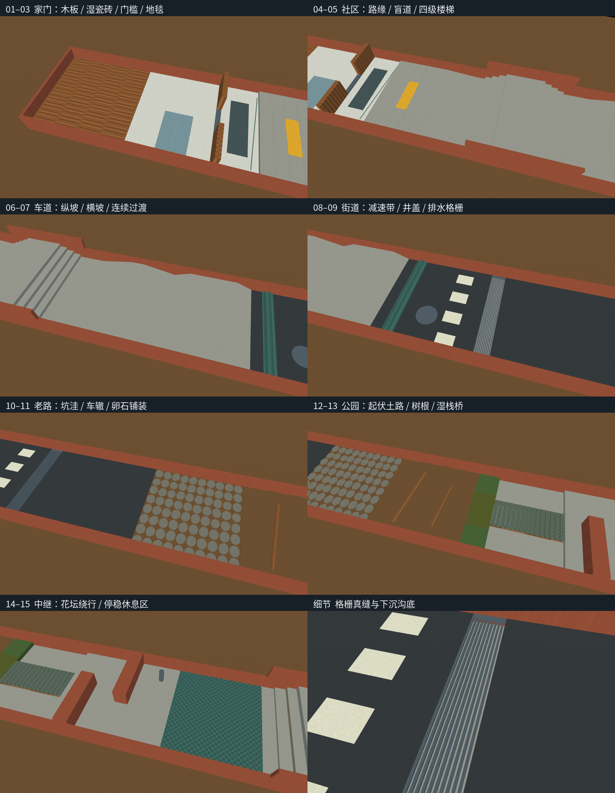
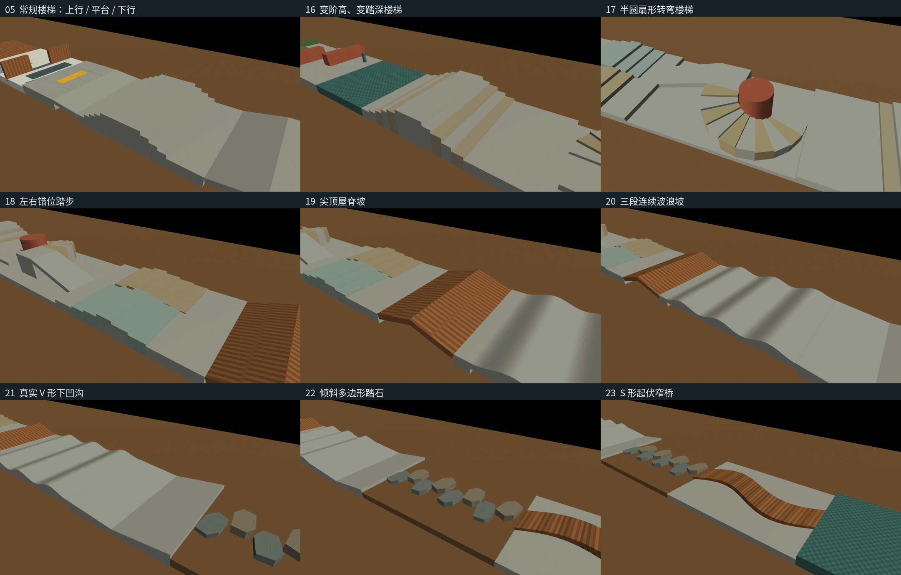

# 最后一公里：机器狗日常世界综合关卡

交付文件：[real_world_final.xml](../../deploy/deploy_mujoco/terrains/real_world_final.xml)。
这是按生活尺度设计的合成场景，不是某处实地测绘。可以单独打开，也可以直接接入项目现有的
`--terrain-xml` 接口；所有纹理、高度场和碰撞几何都内嵌在这一份 XML 中。

场景从家中出发，经过社区、城市道路、公园，绕过花坛后进入异形地形关卡，最后停稳。
本次按反馈补充了变阶高楼梯、半圆扇形楼梯、错位踏步、屋脊坡、波浪坡、V 形沟、斜面踏石
和 S 形窄桥，并将最终终点移到扩展段之后。设计重点是环境之间的过渡：
脚刚离开高抓地地毯就遇到门槛，左右脚可能同时踩在干湿不同的地砖上，下坡后需要适应横坡，
窄栈桥后紧接转向绕障。连续通过比逐个孤立障碍更接近日常使用。

## 路线

沿世界坐标 `+X` 前进，`+Y` 为左侧。具体区间、尺寸、摩擦及修改公式只以 XML 为参数来源。
以下编号与 XML 注释及 `gate_XX` 标记对应。

| 关卡 | 场景和真实碰撞特征 | 主要考察内容 |
| --- | --- | --- |
| 01 | 木地板，板间浅缝，宽敞起步区 | 起立、起步、低速转身 |
| 02 | 抛光瓷砖，局部右湿左干，砖缝 | 抓地突变、左右接触不对称 |
| 03 | 窄门洞、金属门槛、地毯、斜向电缆 | 对中、抬脚、小障碍、接触柔顺性变化 |
| 04 | 抬高人行道、混凝土接缝、盲道凸点、路缘坡 | 上路缘、微小起伏、缓坡衔接 |
| 05 | 上楼、顶部平台、下楼 | 落脚、重心转移、下楼制动 |
| 06 | 车库上坡、坡顶平台、下坡 | 纵向牵引、坡顶过渡 |
| 07 | 排水横坡，首尾连续过渡 | 侧倾、侧滑、足间高差 |
| 08 | 沥青、弧形减速带、金属井盖、低摩擦标线 | 曲面支撑、异材质接触 |
| 09 | 真正镂空的金属排水格栅及下沉沟底 | 小缝隙、接触面积变化 |
| 10 | 连续碗形坑洼和车辙 | 负障碍识别、向下落脚 |
| 11 | 高低不一的固定卵石铺装 | 非平面支撑、离散落脚 |
| 12 | 起伏土路、斜树根、湿落叶、两侧草地 | 复合起伏与抓地变化 |
| 13 | 湿木窄栈桥，板缝及两侧下沉空间 | 路径对中、足位控制、低抓地 |
| 14 | 交错花坛和柱状路桩 | 减速、向左再向右绕行 |
| 15 | 橡胶中继区 | 通过生活场景后停稳，再进入异形关卡 |
| 16 | 不同阶高、踏深的上下楼梯 | 打破固定步幅与节奏，适应连续高度变化 |
| 17 | 半圆扇形楼梯，内窄外宽的踏面，高台转向后下坡 | 转弯上楼、左右脚步幅差异、朝向控制 |
| 18 | 左右分道且前后错开的台阶 | 四足异步落脚、横滚控制 |
| 19 | 尖顶屋脊坡，顶端无平台 | 俯仰变化、腹部与坡顶间隙 |
| 20 | 连续波浪坡 | 周期性俯仰与起伏跟踪 |
| 21 | 真正向下凹陷的 V 形沟 | 下探落脚、谷底过渡、重新上坡 |
| 22 | 倾斜、错位的多边形踏石 | 有限足底支撑、不规则落脚区域 |
| 23 | 具有起伏的 S 形窄桥 | 曲线跟踪、身体对中、侧向落足约束 |
| 24 | 最终橡胶停稳区 | 减速停车、保持姿态、再次起步 |



图片来自实际 XML 的软件离屏渲染，不是示意图，也不是策略通过的视频。因本机软件渲染的
阴影兼容性，预览关闭阴影；几何与接触没有变化。



这些近景使用更低的观察角度和侧向照明；为看清侧面轮廓，只在渲染中隐藏外围围墙。
XML 的围墙碰撞仍在，扇形楼梯中心柱、全部踏步、坑沟和桥面都保留。
原有普通楼梯也单独展示在第一格，避免俯视总览把高度变化压平。

扇形楼梯走上半圆，入口先向左转上楼，出口再转向侧面高台下坡；不能始终沿直线向前。
`fan_route_xy`、`stone_route_xyz`、`s_bridge_route_xyz` 保存参考路线点，供导航或评测读取，
**现有控制器不会自动追踪这些点**。这不是绕满一圈、上下重叠的多层螺旋楼梯，因而仍能用
当前从上方读取单层地表的高程扫描。

## 直接使用

从项目根目录，沿用你当前的机器人和权重命令，只替换地形参数：

```bash
--terrain-xml deploy/deploy_mujoco/terrains/real_world_final.xml
```

完整命令结构如下。把机器人及权重占位路径换成当前使用的文件：

```bash
conda activate m20_wzh
python deploy/deploy_mujoco/deploy_mujoco.py \
  --model /你的机器人目录/M20.xml \
  --checkpoint /你的策略目录/model.pt \
  --terrain-xml deploy/deploy_mujoco/terrains/real_world_final.xml \
  --viewer
```

现有操作是 `Z` 起立、`C` 切换策略，`W/S/A/D/Q/E` 调整移动和转向；`H` 显示高程采样。
本轮没有操作真实键盘，也没有选择策略权重或运行全程策略评测。

只看地形，无须机器人和权重：

```bash
conda activate m20_wzh
python -m mujoco.viewer --mjcf=deploy/deploy_mujoco/terrains/real_world_final.xml
```

图形窗口命令需在有桌面的终端执行；本轮使用的是离屏渲染。XML 已在项目现有 MuJoCo 版本上
编译，旧版本可能不支持内嵌 `hfield elevation`。没有替换现有运行环境。

## 材质与物理的对应方式

每种表面有对应的 `rw_材质名` 默认类和 `rw_mat_材质名` 视觉材质。木板使用方向性纹理，
地毯/橡胶使用细密花纹，混凝土、沥青、泥土等使用颗粒纹理；湿表面改变色泽及镜面反光。
这些是程序纹理，不是照片级纹理，纹理本身不会增加接触起伏。会影响足部的砖缝、木板缝、
盲道凸点、格栅、坑洼、石块和树根均另外建成了真实几何。

`friction` 的三个量依次控制滑动、扭转和滚动摩擦；后两项具有长度单位。场景使用
`condim="6"`，使三类阻力都参与接触求解，因而对当前轮足 M20 也会引入小的滚动阻力。
地毯、草地和落叶的接触柔顺性另有区分。**这些是用于测试的假设参数，不是材料常数或
某种轮胎/脚垫的实测值**；更换接触材料、载荷或环境后需要标定。

场景的接触 `priority` 高于当前 M20。这样湿砖的较低摩擦不会被机器人侧的较大摩擦取代；
该优先级也决定接触维度和求解参数。更换机器人时应重新检查实际 `data.contact`，
尤其注意显式 `contact/pair` 和全局接触覆盖设置。这遵循
[MuJoCo 接触参数规则](https://mujoco.readthedocs.io/en/stable/modeling.html#contact-parameters)。

全局物理步长、积分器和摩擦锥由调用方控制，地形不指定这些选项；独立打开时使用 MuJoCo 默认值。
可视纹理、高度场归一化和行序的说明见
[MuJoCo XML 参考](https://mujoco.readthedocs.io/en/stable/XMLreference.html#asset-hfield)。

异形踏步和曲桥不是一个整体凹形网格：每级扇形踏步、每块多边形踏石和每段桥面分别采用
凸网格，避免凹口或弯道被整体凸包填平。这符合
[MuJoCo 网格碰撞模型](https://mujoco.readthedocs.io/en/stable/computation/#collision-detection)
的限制。每个网格的顶面高度除射线外，还检查了实际球体接触；图片中看见的轮廓不是唯一依据。

地面分段建模，兜底平面置于道路之下。格栅和桥板间隙、坑洼、桥侧沟槽具有真实负高程，
没有隐藏的齐平地板托住脚。两侧围边用于限制直接绕过整个关卡，但不能替代轨迹判定。

## 验证与适用边界

完整数值见 [checks.json](checks.json)，可复跑入口为 [verify.py](verify.py)。验证包含：

- 原生场景独立编译，以及现有 `deploy.load_model()` 加载实际 M20 模型；机器人质量、关节及执行器名称/顺序保持一致。
- 独立指定的正、负高程点；干湿表面和坡面；落到沟底的格栅缝与栈桥缝。
- 每种材料的物理接触系数与维度；相同初速的测试块在干湿砖上滑行。
- 实际 M20 在两种砖面上使用现有 PD 代码短时物理落地，读取接触摩擦。
- 多位置、多朝向的现有高程扫描，与独立场景射线对照。
- 反例检查：纯平地应无法通过凹凸高程断言；去掉地形优先级应无法保留设定的低摩擦。
- 扩展区独立高程点和全部凸网格的球体接触；给 S 桥侧面错误填入整块地板时，负障碍断言应拒绝它。
- 扇形楼梯公共边与连续弧线扫描；修复前的网格作为反例，确认检查能抓住公共边漏射线。

扩展形状单独复跑：`python docs/real_world_final_20261013/verify_shapes.py`，无需机器人或权重。
输出为 [shape_checks.json](shape_checks.json)。

```bash
OMP_NUM_THREADS=1 OPENBLAS_NUM_THREADS=1 MKL_NUM_THREADS=1 \
LP_NUM_THREADS=1 MUJOCO_GL=osmesa \
python docs/real_world_final_20261013/verify.py \
  --model /你的机器人目录/M20.xml --render
```

**未验证：策略全路线通关、各段通过率、动态行人、实际机器人通过能力。** 本轮没有启动训练，
没有改变其它地形、控制器、加载器或权重；本文件原有生活关卡的表面与接触参数保持一致，
终点围墙和终点元数据移到扩展区末端。加载/接触通过，不等于策略已具备处理这些障碍的能力。
现有控制入口只判断终点越线，`gate_XX` 只是供后续评测读取的位置标记，不会自动判定经过顺序。
严谨的通关评测应同时记录各段实际轨迹、跌倒/碰撞、滑移、桥侧落足与终点停稳；不能仅看越线。

草、土、地毯和落叶仍是固定几何与接触参数的近似，没有模拟土壤塌陷、地毯变形、叶片滑动、
水膜或流体。固定卵石不等于散碎石。静态场景也不含传感器噪声、雨雾、风、材料随机化或动态
交通。没有顶棚与隧道，避免现有单层高程图把顶棚误当脚下地面。

## 本轮运行记录

资源与检查结论以本次 `checks.json` 为准。检查使用单 CPU 进程、单 BLAS/软件渲染线程，未使用
CUDA 运算。最初的进程地址空间限制使 PyTorch 所依赖的 CUDA 动态库无法映射，后放宽地址空间
上限并完成复跑；这是共享库虚拟地址映射问题，不是地形编译失败。仍使用进程时间和总运行时间
上限，实际常驻内存峰值随检查结果保存。资源依据、改动前文件哈希保存在任务 scratch 目录。

本轮按 `multi-round-review` 做独立只读复核；可用 reviewer 与作者同属 Codex family，
没有把此次复核标作异构模型评审。

扩展后 XML 实测包含 378 个碰撞几何、38 个独立凸网格、16 类材质和 5 个高度场；
场地道路从 x=-2 到 x=102，主路宽 4 米，出生点到统计终点相距 101 米。
MuJoCo 3.10.0 编译和部署加载通过。主检查覆盖 64 组朝向/位置的 187 点扫描；
干湿砖面 M20 各读取到 12 个接触，
有效滑动摩擦分别为 0.60 / 0.22。同初速测试块的滑行距离分别约 0.084 / 0.231 米。
新增的 38 个凸网格逐个通过物理接触检查，原有 296 个未搬移/扩边的几何及全部原有资产、
接触默认类保持一致。以无资源目录的 XML 字符串重新编译，也验证了单文件自包含。
初版生活段的独立 reviewer 曾做过 70,400 个射线采样；这不是扩展段的通关或覆盖结论。

扩展段复核发现扇形踏步在编译后出现浮点级细缝：球体接触正常，但恰好落在公共边的
高程射线会穿到沟底。已给相邻凸网格的公共边增加微小重叠，并保留修复前反例。
最终独立复核的 3,240 个接缝射线与 496 个连续参考路线点均未漏到沟底；全部网格封闭、
凸性与面朝向检查通过，桥外和扇形内外空区也检查了误填充。

上述数字是本轮验证快照，修改后须重新运行；调参仍以 XML 为准。
独立复核与资源限制说明见 [verification_notes.txt](verification_notes.txt)。
