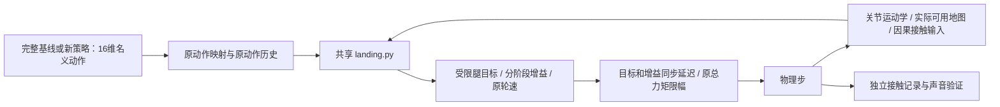

# quiet_v1 研究融合后的控制实现

本文件描述代码，不是声音达标声明。原始 46400 教师和 21000 学生不变；
真实 LAeq/LAFmax 的 dB 读数下降 50% 仍由原声学协议验收。
当前无校准 M20 上楼录音，不输出实测下降百分比。

## 从研究中选取的机制

- 从 Go1 导盲机器人控制和 CENTAURO 研究提取接触前轨迹整形：
  在碰撞前改变腿目标，而不是等首峰后才调阻尼。
- 从 CENTAURO、Sony QuietWalk 提取事件反馈和分阶段增益：
  区分摆动、接近、加载和稳定支撑；提前接触时限制继续压入。
- 从 sim-to-real 执行器研究提取测量、辨识与留出验证：
  不把理想 PD、固定延迟或未核实电流字段当成真实执行器。
- 保留已有八项物理成本，供控制层与策略联合训练及消融。
  这些机制没有继承论文的声学降幅或稳定性证明。

原始来源和反例在 [RESEARCH.md](RESEARCH.md)。

| 来源 | 本次实际接入 | 没有继承的结论 |
|---|---|---|
| [Sony/ETH QuietWalk](https://arxiv.org/html/2502.10983v2) | 接触阶段反馈与有限增益调度 | 没有复现其学习增益策略，不能继承 aibo 的声音降幅或地形通过率 |
| [UMass Go1 导盲机器人](https://arxiv.org/html/2505.11808v2) | 接触前参考轨迹整形这一设计原则 | 没有移植完整 NMPC/WBIC，不能继承平地声音结果 |
| [CENTAURO 变刚度](https://www.frontiersin.org/journals/robotics-and-ai/articles/10.3389/frobt.2022.874290/full) | 接触确认、加载阶段与支撑恢复 | 没有实现其能量约束优化，不能继承被动性或稳定性证明 |
| [PACE](https://github.com/leggedrobotics/pace-sim2real) | 离线时间对齐、延迟/响应拟合和留出验证原则 | 当前只是运动学响应辨识工具，未拟合真实 M20，也不是完整 PACE 复现 |

地形空间缓存、冲突失效、执行契约和导出检查是针对本项目接口缺口的工程设计，
不是上述论文已经验证的 M20 方案。不会因为叠加了多个机制就预设它们的收益可以相加。

## 运行链路



三类入口仍为 `stair_quiet_v1_env.py / stair_quiet_v1_env_cfg.py /
stair_quiet_v1_ppo_cfg.py`。教师和学生配置/环境类共用这些入口，
专用工具均在本任务目录。`landing.py` 是唯一控制公式与参数源。

`LandingController` 使用四轮支持点的世界法向速度、局部踏面距离和腿 Jacobian，
将接近速度与制动距离、执行延迟余量联系起来。控制的是短时位置参考，不是已证明
可满足的硬速度约束。完整点 Jacobian 的阻尼逆将法向参考修正映射回关节；
整腿统一缩放和速率约束避免逐关节裁剪改变修正方向。

接触确认使用滞回和持续时间；只有之前存在有效离地证据，才开启新落地加载阶段。
缺失接触输入不被当成腾空。增益恢复有速率限制；已承重腿不同时软化。
支撑不足、Jacobian 退化、地图未知或阶沿高度不连续时，不产生新的静音修正，
并记录失效或不可实现计数。旧修正有限速地回到名义值。
这不是一个完整稳定性控制器，旁路恢复也不能保证原策略在任意扰动下成功。

当前实现范围是**水平踏面上的有限参考修正与腿关节增益调度**：

- 不改变碰撞材料、接触求解器或轮胎几何。
- 不修改轮速；轮速同步和完整轮腿 MPC 尚未接入，避免未验证的切向干预。
- 不把脚触立面当成可靠支撑。未观测立面、复杂棱边和多点接触仍是覆盖缺口。
- 没有真实声音在线优化、机械轮面改造或 RMA 自适应模块。
- 触地后控制只能影响后续加载与反弹；首撞仍依赖接触前预测是否及时。

## 训练、学生与部署一致性

Isaac 每个物理子步在名义动作应用后、显式执行器计算前接入控制。
对显式 DelayedPD 修改其刚度/阻尼，不额外开启 PhysX 隐式驱动；
增益与目标使用同一执行器 lag，重置恢复/重取基准增益，避免反复相乘。

教师保持原 244 维 policy、285 维 critic 和 3 维 raw command。
学生任务保持 789 维输入和 16 维名义输出，学生 actor 与控制层共享其收到的地图：
缺失、延迟和裁剪不能用仿真真值填补。动作标签仍是完整教师的名义动作，
而不是把控制后的关节目标错误地当成网络标签。

前向传感器的当前网格不能覆盖后轮，因此新增有界的观测地形记忆：
仅保留已经有效观测的世界坐标地图样本，供后轮随后通过同一踏面时使用。
时效从原采样时间计算，重复交付不能续命；位置/航向跳变、重置、过期与矛盾观测
都要进入失效处理。缓存容量、空间量化和更新周期取自 `LandingSettings`，
不复制新的参数台账。缓存时长的原型依据是前可见区到后轮的通过时间，
加感知延迟与更新余量；不代表真实定位在该时长内一定准确。
仿真中的全局位置/航向仍来自模拟状态，真实 LIO 的漂移与重置必须另行验证。

原学生地图的固有延迟超过十分之一秒，因此控制器的地图过期界限与学生当前
地图有效期一致；这只避免所有学生样本静默失效，并不是实机延迟可接受性证明。
控制输入覆盖率和实际修改次数必须报告，零修改不能称为新控制有效。

接触力目前仍是仿真提供的因果观测，明确标为 oracle。
正式 SDK 的接触接口恒零，尚无经过验证的等价实机输入。
因此新 checkpoint 带执行契约和源码哈希；专用训练、恢复和基准必须匹配。
旧蒸馏、MuJoCo、ONNX 和正式 SDK 导出入口会拒绝带控制标记的模型，
防止只部署 nominal actor 而静默丢掉外部控制层。
这些护栏覆盖受控入口，不能阻止人为剥除元数据后的裸权重使用。

## 电脑验证与失败处理

1. 用关闭控制的路径验证原 PD/原模型结果，原 checkpoint 哈希必须一致。
2. 同一网络比较 `precontact / phase / combined`；控制角色明确标记为
   “原 actor + 新控制层”，与“新训练 actor”分开。
3. 相同种子、几何、材料和速度命令，比较完整上楼、停住、实际时长、声音预测。
4. 相同压力 profile 配对注入地图高度误差、接触丢失/迟到、执行延迟、响应滞后和
   力矩能力下降；失败试次保留，不用降低任务要求让它晋级。
5. 未标定声音模型只用于假设敏感性。只有校准录音/可信声压数据能裁定真实声音。

`actuator_id.py` 用已有时间戳日志做离线运动学响应辨识：
命令按真实时间零阶保持，数据分为拟合/选择/最终留出段。
输出只称运动学响应拟合，不称力矩标定、接触辨识或实机控制许可。
没有数据时不会生成虚构 M20 参数。悬空拟合还必须接受承载运动的独立验证。

```bash
PYTHONPATH=source/rl_training python -m task_support.stair_quiet_v1.actuator_id \
  /path/to/actual_recording.npz /path/to/recording_metadata.json /path/to/new_fit.json
```

输入必须是实际发出的物理目标与带时间戳关节状态，不接受 normalized policy action
冒充执行器命令。必需数组、单位、时钟和工况声明见该命令的 `--help`；
本轮没有真实日志，不以单元测试的合成轨迹生成实机辨识报告。

真实机器人尚需：发布版身份和实际时序、可信触地估计、总 PD 饱和/执行器响应、
载荷与材料变化、同条件校准声音。本轮代码改造不替代这些实测。
长时间教师训练和学生蒸馏由用户按项目操作指南启动。
