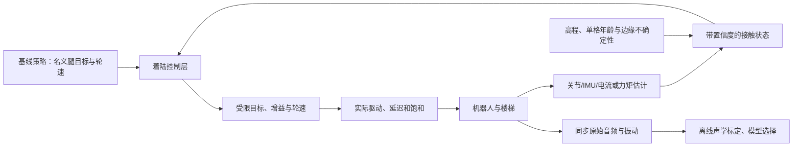
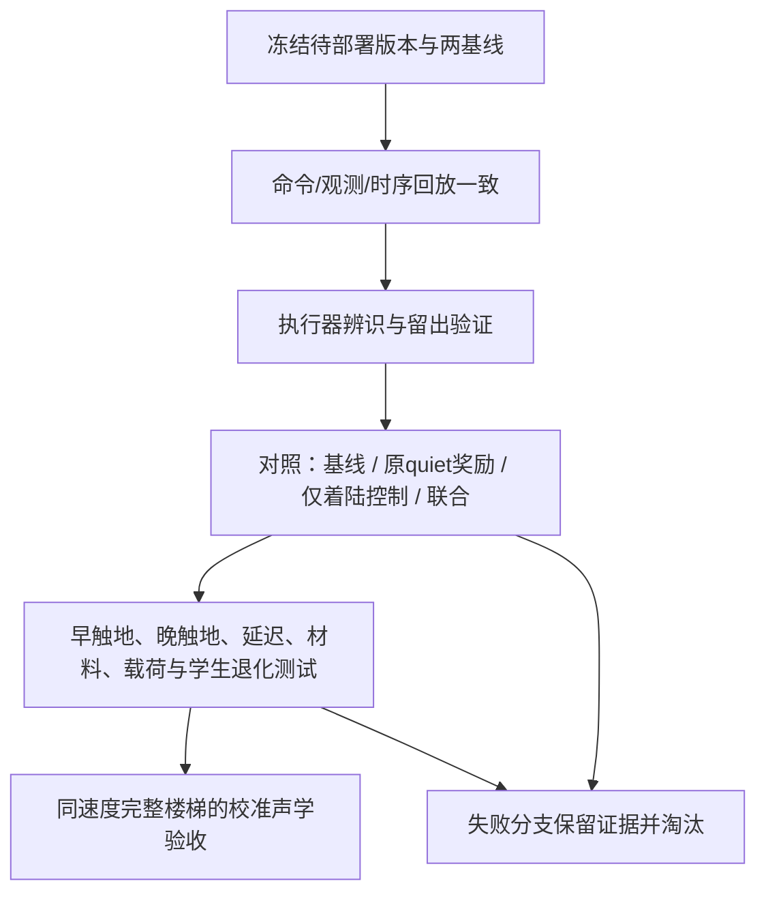

# quiet_v1：砸地声控制与实机迁移选型

检索与本地审计日期：2026-10-20（Asia/Shanghai）。

本页是联网研究后的设计裁决，**不是已实现的新控制器或降噪达标报告**。
后续已实现的子集及尚未接入的部分见 [CONTROL.md](CONTROL.md)；本页保留研究时的证据边界。
原始教师 46400、学生 21000 和“LAeq/LAFmax 的 dB 读数相对两基线至少下降 50%”
要求保持不变。没有启动长训练、接管机器人、修改实机增益或替换基线。

## 裁决

优先研究 **接触前速度整形 + 触地事件反馈 + 有边界的分阶段阻抗**，
并把实测执行器/延迟/感知误差纳入训练和验证。当前八项物理奖励保留为对照组，
不继续把增加奖励项当作主要进展。

理由是：已有真实声音研究支持改变足端轨迹和控制方式；真实轮足研究则表明，
固定低刚度或缺少早/晚触地反馈会失去爬阶能力。这比单凭力学代理推断声音更有依据，
但仍不能把其他平台的分贝结果转给 M20。

## 原始研究与证据边界

下表区分声学证据、运动性能证据和设计推论。数字沿用作者口径，
不能将 MNL、频谱幅值或峰值统称为校准 LAeq/LAFmax。未独立复现论文结果。

| 原始来源 | 核对的内容 | 对 M20 的裁决 |
|---|---|---|
| [Sony/ETH，Learning Quiet Walking，ICRA 2025](https://arxiv.org/html/2502.10983v2)；[官方演示](https://sony.github.io/QuietWalk/) | 动作同时调关节目标与 PD 增益，足底开关进入反馈，采用课程。实际 aibo 更安静，但最静音策略的坡地能力退化；官网展示约 7° 坡失败。声音用机载麦克风和参考信号，不是本任务标准声级验收。 | 借鉴接触反馈与可变增益；拒绝直接移植参数、降幅或鲁棒性结论。公开 Sony 仓库是项目页，不能算已有完整训练实现。 |
| [UMass，Human-Centered Development of Guide Dog Robots，2025 预印本 / ICRA 2026](https://arxiv.org/html/2505.11808v2) | Go1 使用 NMPC+WBIC、低步频和平滑摆腿/触地；0.6–1.2 m/s 平地四档比较报告平均约降低 10 dB。采用随行耳高手机测量，未核完整校准及 A/Fast 协议。另有视觉高程辅助宽阶楼梯实验。NMPC 约 400–500 Hz，WBIC 500 Hz。 | 最有价值的非奖励路线之一：低步频不等于低前进速度。不能将平地降幅移用于楼梯，也不能将作者的感知响度减半当作 dB 读数减半；完整 MPC 移植需先证明板端计算预算。 |
| [Zhao 等，Variable stiffness locomotion，Frontiers 2022](https://www.frontiersin.org/journals/robotics-and-ai/articles/10.3389/frobt.2022.874290/full) | 真轮足 CENTAURO 使用触地事件、刚度/接触力联合优化与被动性约束；在 6 cm、4 cm 台阶上对照。固定低刚度和关闭触地自适应存在失败。控制模块约 200 Hz。 | 优先迁移“提前柔顺、触地确认、支撑恢复”的机制。台阶明显低于本项目 17 cm 场景；只测冲击/运动，不是声学证据。论文稳定性条件不能自动继承给任意 PD 切换。 |
| [MUTE，Minimizing Acoustic Noise，2025](https://arxiv.org/html/2506.23114v1) | Go1 多材料实验有直接声音比较，但最高静音档存在实际速度牺牲。 | 作为奖励类对照；不能只按相同速度指令判定公平。须核实际上楼时间与速度分布。 |
| [QuietPaw，2025](https://arxiv.org/abs/2503.05035) | 条件化约束策略处理机动性与安静度的权衡。 | 借鉴约束/偏好条件化，避免一组固定惩罚适用于所有场景；不等于有实时声压闭环。 |
| [TACET，2026-10 预印本](https://arxiv.org/abs/2610.03828)；[官方项目](https://rcilab.khu.ac.kr/tacet/) | 作者报告同速最高降低 9.3 dBA。官方页正文称实际速度匹配，表注仍称 commanded speed；代码标为 Coming Soon。 | 仅作为近期支持证据，速度数据和独立复现仍缺。借鉴步态调度，不为上楼降噪引入无关 VLM/社交导航系统。 |
| [Hu 等，QuietWalk，2026，不同于 Sony 同名工作](https://arxiv.org/html/2604.23702v1) | 用动力学约束力估计处理不同鞋/地面；真机报告平均/峰值声音变化，并说明录音链绝对校准限制。 | 借鉴接触状态估计和跨材料验证；估计 GRF 仍不是声压。不能将其力估计误差降幅当成声音降幅。 |
| [PACE，2025，2026-07 修订](https://arxiv.org/html/2509.06342v2)；[作者代码](https://github.com/leggedrobotics/pace-sim2real) | 用固定基座、腿悬空的编码器数据辨识执行器/关节动力学，显式处理延迟、摩擦等。多平台验证，公开代码与数据。 | 优先借鉴可解释执行器辨识；悬空拟合不覆盖轮胎—楼梯接触，须另做承载与接触验证。它证明迁移方法，不证明静音。 |
| [SPI-Active，2025](https://arxiv.org/html/2505.14266v1) | 通过并行采样和针对性采集辨识物理参数，减少盲目域随机化。 | 可作为离线参数拟合的第二方案；不自动执行论文的真实主动探索动作。 |
| [Actuator Reality Shaping，2026-07](https://arxiv.org/html/2607.02205v1) | 在驱动层塑造闭环执行器响应，另有轮腿坡面演示。 | 暂不作为首选：需要更深驱动控制权限与带宽验证，目前 M20 可用接口不足以继承其条件。 |
| [TPMS 足与形态感知 RL，2026](https://ntu-repository.worktribe.com/output/2686410) | 原始研究量化的是电池功耗改善，不是声音指标。 | 软轮面/阻尼结构值得硬件支线研究，但不能引用媒体“quieter”标题当实测声学收益。 |

检索覆盖近两年、近一年和近三个月，保留较早但直接涉及真实轮足触地的研究。
公开项目页、官方代码和他组同类结果分别记录；本轮没有确认这些方法在 M20 上的
独立复现，也没有发现本轮核对的研究能证明 M20 同等速度上楼的 dB 读数减半。

## 推荐的控制结构（尚未实现）

1. **接触前减速。** 利用足端相对目标面的法向距离和逼近速度，在撞击发生前
   调整末段轨迹。地形位置误差、数据年龄、计算及执行器延迟都进入制动余量。
   不能等麦克风听到“砰”再指望消除这一次撞击。
2. **触地事件修正轨迹。** 提前触地时停止向该接触面继续推进名义摆腿目标；
   到预期时间仍未触地时，以受限速度寻地并维持其余支撑。必须区分踏面接触、
   撞立面和轮缘卡住，不能把所有接触都当成已经获得支撑。
3. **分阶段阻抗。** 摆动阶段维持落点精度，接近触地时降低冲击方向的刚度并配置
   阻尼，接触稳定后逐渐恢复承载能力。约束增益范围、变化率、关节/电机负载、
   摩擦与支撑裕度；不把“所有关节 Kp 降低”当作静音控制。
4. **轮腿联合接触。** 在可靠踏面上匹配轮缘切向速度，减少滑擦和突然抓地；
   跨立面/棱边时同时满足轮半径、碰撞几何、腿可达性与摩擦约束。
   滚动上阶是候选模式，不能因平地轮式安静就假定任意楼梯可以连续滚过去。
5. **一致的训练与部署。** 控制层若在部署端存在，就必须在教师训练、学生蒸馏、
   MuJoCo 对照中存在。首个原型可保留 16 维名义策略输出，把附加控制明确放在
   任务控制层；若改为学习增益，新输出契约必须显式版本化，不能交给旧部署器解释。
6. **声音闭环先用于离线选型。** 用同步的未降噪原始音频、接触/关节状态和振动数据
   拟合声音映射，并在未参与拟合的楼梯/材料上验证。可以用真实声音筛选有限组
   轨迹和阻抗参数，但本轮不开展真机在线探索，也不将麦克风当作低延迟触地传感器。

## 实机退化必须正面验证

| 退化场景 | 降噪方案可能怎样失效 | 方案/验证要求 |
|---|---|---|
| 台阶比地图高、雷达遮挡、单格过期 | 高刚度阶段提前撞上，或把立面当踏面 | 早/晚触地反馈；按格点年龄和边缘误差设余量；未知输入不伪造平地 |
| 感知/策略/执行器延迟与调度抖动 | 触地前制动变成触地后制动 | 采集完整时间链与尾延迟，回放突发抖动、丢帧、旧样本；不是只加一个固定延迟 |
| 固件限矩、电压下降、热降额、传动摩擦 | 仿真能执行的制动在真机饱和 | 识别实际闭环响应、总 PD 饱和和可用制动力；训练与回放使用相同作用点 |
| 瓷砖/木板/空心金属梯、湿滑或磨损轮面 | 同样机械冲击对应不同共振/摩擦声音 | 按材料分层报告声音；接触、摩擦与辐射分开标定；留出材料做验证 |
| 多轮同时支撑、载荷变化、短踏面 | 过软导致下沉、失去落点或拖轮 | 按支撑需求限制柔顺性；联合检查姿态、轮滑、完成时长和负载，不仅检查声级 |
| 学生蒸馏/ONNX/C++运行差异 | 接触时序和制动幅度发生偏移 | 用相同输入时间序列贯穿教师/学生/Python/C++最终指令；学生单独声音验收 |
| 置信度低或控制不可行 | “静音优先”把机器人推入失稳 | 有界退出到已验证的支撑/恢复行为；该段记作降噪任务失败，不利用停住稀释声级 |

随机化范围应由真实记录和辨识残差确定。先检验辨识模型，再训练针对剩余不确定性
的鲁棒性；不能无限扩大随机化，强迫策略用更猛烈的动作对抗所有假设扰动。

## 本地部署审计的范围与发现

实际存在独立工程 `m20_student_v3_5_deploy`。其 v3.5 导出和 SDK 插件处理
789 维观测、历史及命令反馈；旧 `xyproject/m20_sdk_deploy` 的通用 LiDAR runner
不是等价替代品。本轮只读本地源码/历史记录，没有核对机器人当前 PID、发布版或运行配置。

正式工程仍明确保留以下边界：

- `deploy/robot.json` 的执行契约说明总 PD 限矩尚未与 MuJoCo 实证等价。
- 部署没有为了匹配仿真而添加人工执行器延迟；应比较实际延迟分布，不能再机械地
  叠加一份延迟。
- 额外目标裁剪开关关闭；极端轮动作与训练 processed clip 存在差异。
- 固定增益是当前名义接口；新增可变增益虽可利用 SDK 字段，仍需重新验证驱动行为。
- 正式 SDK 的 `vendor/interface/robot/hardware/dds_interface.hpp:416–417`
  中 `GetContactForce()` 恒返回四维零向量。触地闭环须先建立并验证接触估计，
  或增加传感器；不能直接把该接口当作已存在的真实接触观测。力矩反馈的物理含义
  也仍需核实。
- 本地状态机节拍为 200 Hz，名义策略/命令发布为 50 Hz；电机固件内部伺服频率
  未核实。循环定时器频率不能代替端到端执行带宽。
- 配置声明的时限、仓库旧记录与具体发布版可能不同。以准备部署的内容哈希和实测
  时序为准，不能把旧故障记录说成当前机器仍有相同故障。
- 历史 `deploy20000_20261020/deployment_summary.json` 只记录 model_20000
  的初始化/数值检查，明确未验证实际站立、行走和楼梯。它不能替代本任务
  model_21000 的真实闭环证据。

本轮补充报告：
[部署源码审计](../../../../logs/evaluation/stair_quiet_v1/research_20261020/deployment_audit.md)、
[声学原始证据](../../../../logs/evaluation/stair_quiet_v1/research_20261020/acoustic_sources.md)、
[控制原始证据](../../../../logs/evaluation/stair_quiet_v1/research_20261020/control_sources.md)。

## 复现条件与剪枝

| 路线 | 算力/频率与当前缺口 | 接线与训练代价 | 最先否决它的实验 |
|---|---|---|---|
| 受限着陆控制层 | 计划 CPU 小规模运动学/状态机；目标循环取实测 SDK 可达周期，尚无板端延迟/内存实测 | 要接触估计、碰撞几何、真实增益和延迟；可先控制层单独对照，联合训练由用户启动 | 提前触地或地图失效时反而冲击更大；支撑/爬阶失败 |
| NMPC/WBIC 或其训练参考 | 文献的 400–500 Hz 不代表 M20 可达；需要目标板整机共载预算、求解尾延迟 | 轮接触非完整约束、状态估计与力矩接口改造较大；可先离线生成可行参考再蒸馏 | 求解超时、状态误差使落点/接触力不可行 |
| PACE式执行器辨识 + 定向随机化 | 离线拟合用工作站；本轮未运行拟合/训练，板端只需原始时序记录 | 需真实命令与编码器/状态数据；接触模型另辨识 | 留出轨迹预测不准，或悬空拟合到承载接触失效 |
| 阻尼轮面/机械隔振 | 不增加推理算力，但必须测轮径、负载变形、滑移和温度/磨损 | 需要实际样件和材料辨识；改变硬件后重做模型与策略验证 | 声音改善伴随打滑、滚阻增加、磨损/脱落或支撑变差 |

暂不采纳：全局减小 Kp、临时在部署端单独加低通滤波、依赖完美地图的固定触地计时、
通过换路线/慢走冒充同条件降噪、用 ASR 降噪后的录音验收、引入 VLM 控制静音档、
直接把未标定声音模型作为真实 dB 奖励。驱动层 reality shaping 与完整 MPC 保留为
后续选项，先证明接口、算力和辨识条件。

不把多个改动一次混合后只看总收益。事件推进的实验顺序是：

本页只完成选型和迁移分析。各路线的 M20 端到端耗时、显存/内存、控制效果及实际
分贝降幅均未测；因此裁决为“优先原型验证”，不能标为“已可用”。
长时间教师训练和学生蒸馏继续由用户启动；物理动作不属于本轮研究执行内容。
